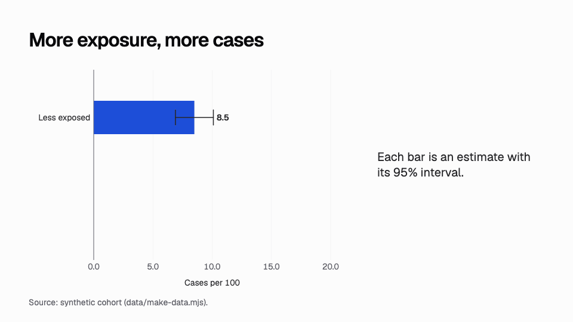

# stepdeck

*Presentaciones HTML paso a paso, escritas como datos, que los agentes pueden construir.*

[](https://github.com/horaciochacon/stepdeck/actions/workflows/ci.yml)

[English](README.md)



[Sitio en vivo](https://horaciochacon.github.io/stepdeck/) · [Galería de cada layout y componente](https://horaciochacon.github.io/stepdeck/site/gallery/)

stepdeck es un motor de presentaciones HTML paso a paso. Las diapositivas son datos simples: un layout, los elementos en sus regiones y una lista de pasos. El motor acumula los pasos en un estado por paso, los componentes renderizan las props de ese estado y una herramienta de línea de comandos revisa el mazo en cada paso. Un mazo son archivos estáticos con el motor copiado dentro. Corre en Chrome sin paso de compilación, sin CDN y sin red en el momento de presentar.

Esta página es la puerta de entrada. Muestra lo que incluye, un inicio rápido y una diapositiva, y luego lleva a quienes escriben mazos, a quienes operan agentes y a quienes contribuyen a la página adecuada de [docs/](docs/index.md).

**Estado.** Primera versión pública (0.1.0), con un [sitio de documentación](https://horaciochacon.github.io/stepdeck/site/docs/) y una [galería](https://horaciochacon.github.io/stepdeck/site/gallery/). El kit incluido tiene 11 componentes y 5 layouts. El tema por defecto es `modern`, y `academic-light` es la alternativa sobria; véase el [registro de cambios](CHANGELOG.md). La exportación a PDF no está implementada.

## Qué incluye

| Pieza | Qué hay | Referencia |
|---|---|---|
| Componentes | 11: `text`, `markdown`, `chart.line`, `chart.bar`, `big-number`, `terminal`, `list`, `diagram`, `chat`, `timeline`, `image`. Cualquier otra cosa es un componente propio con el mismo contrato. | [Componentes](docs/reference/components/index.md) |
| Layouts | 5: `title`, `figure-notes`, `full-bleed`, `statement`, `halves` | [Layouts](docs/reference/layouts.md) |
| Temas | 2: `modern` (el tema por defecto: Geist, un acento azul profundo, un título de portada grande) y `academic-light`, con paletas seguras para daltonismo y fuentes incluidas | [Temas](docs/reference/themes.md) |
| Shells | 2: `reveal` para presentar (teclado, vista del presentador), `bare` para las revisiones de la CLI | |
| CLI | 9 comandos: `help`, `new`, `new-component`, `catalog`, `serve`, `validate`, `dump`, `check`, `shoot` | [CLI](docs/reference/cli.md) |

## Inicio rápido

Necesitas:
- Node 20 o posterior;
- `npm install` en este repositorio, para Ajv (solo `validate` lo necesita);
- Chrome y Playwright para los comandos de navegador (`check`, `dump`, `shoot`). Playwright no es una dependencia: instálalo donde Node lo encuentre, o define `STEPDECK_PLAYWRIGHT` con la carpeta de un paquete `playwright`.

Luego:

```sh
git clone https://github.com/horaciochacon/stepdeck.git
cd stepdeck
npm install
node cli/index.js new ../my-talk       # un mazo de tres diapositivas que funciona; el motor se copia en my-talk/stepdeck/
node cli/index.js serve ../my-talk     # imprime una URL; ábrela en Chrome
```

En la presentación, las flechas o la barra espaciadora avanzan paso a paso, `S` abre la vista del presentador y el hash de la URL `#/<slide>/<step>` lleva a cualquier paso.

Revisa tu trabajo:

```sh
node cli/index.js validate ../my-talk          # en Node: esquemas, props en cada paso, datos, rutas
node cli/index.js check ../my-talk --played    # en Chrome: maquetación, fuentes, contraste, errores, reproducido frente a saltado
node cli/index.js shoot ../my-talk             # un PNG por paso en my-talk/shots/960/
```

El recorrido completo está en la [guía de inicio rápido](docs/guide/quickstart.md).

## Una diapositiva

Este es `slides/chart.js` de la plantilla `talk` que copia `new`:

```js
export default {
  id: "chart",
  layout: "figure-notes",
  title: "Group B overtakes Group A after 2020",
  elements: [
    { id: "chart", region: "main", type: "chart.line",
      props: { data: "data/series.csv", x: "year", y: "value", series: "group",
               series_shown: ["Group A"],
               axes: { x: "Year", y: "Indicator per 1,000" },
               format: { x: "d", y: ",.0f" } } },
    { id: "note", region: "notes", type: "text", from: "mark",
      props: { role: "note", text: "From 2020 on, Group B rises three times faster than before." } },
    { id: "latest", region: "notes", type: "big-number", from: "latest",
      props: { value: "{{data/summary.json#/latest_b}}", format: ",.1f", label: "Group B in 2024, per 1,000" } },
    { id: "source", region: "footer", type: "text", props: { role: "source", text: "Source: synthetic example data (data/make-data.mjs)." } },
  ],
  steps: [
    { id: "base", notes: "Start with one series." },
    { id: "compare", set: { chart: { series_shown: ["Group A", "Group B"] } } },
    { id: "mark", set: { chart: { annotate: [{ x: 2020, label: "2020" }] } } },
    { id: "latest", only: { chart: { highlight: "Group B" } }, notes: "Land on the figure." },
  ],
};
```

Cada paso parcha el estado del paso anterior, así que se puede llegar a cualquier paso directamente y se ve igual que reproducir hasta él. El número grande sale de un archivo de datos mediante un enlace `{{file#/pointer}}`, así que ninguna cifra se escribe a mano.

Construye la tuya en [Your first deck](docs/guide/first-deck.md) (tu primer mazo); las reglas de los pasos están en [The step model](docs/guide/step-model.md) (el modelo de pasos).

## Mapa de la documentación

| Página | Para |
|---|---|
| [docs/index.md](docs/index.md) | El inicio de la documentación: todas las páginas, por público |
| [Guías](docs/index.md#guides) | Quienes escriben mazos: inicio rápido, primer mazo, modelo de pasos, datos, layouts, presentar, revisar, componentes propios |
| [Referencia](docs/index.md#reference) | Especificación del mazo y de la diapositiva, componentes, layouts, temas, CLI, reglas, API de ejecución, contrato de componentes |
| [Conceptos](docs/concepts/architecture.md) | Cómo encajan las piezas: motor de acumulación de pasos, controlador de diapositiva, renderizador de layouts, registro, shells, CLI |
| [Contribuir](docs/contributing/index.md) | Trabajar en el motor: preparación, pruebas, añadir componentes, layouts, temas y reglas |
| [Solución de problemas](docs/troubleshooting.md) | Errores comunes y qué hacer con ellos |

La documentación en `docs/` y la skill están en inglés.

## Para agentes

La [skill](skill/SKILL.md) enseña a un agente todo el flujo de trabajo sin leer el código del motor: catálogo, especificación de la diapositiva, `validate`, `check`, `shoot` o `dump`, mirar, corregir. Sus `references/` cubren el modelo de pasos, los componentes, los componentes propios, los temas y layouts, cada regla de revisión, y un recetario. La skill está en inglés. El repositorio es también un plugin de Claude Code (`.claude-plugin/plugin.json`), que carga la skill; cárgalo con `claude --plugin-dir /ruta/a/stepdeck`. Cualquier otro agente puede leer `skill/SKILL.md` directamente.

La documentación y la skill coinciden. Para usar agentes con stepdeck, empieza por [stepdeck for agents](docs/guide/for-agents.md) (stepdeck para agentes).

## Estructura del repositorio

- **Motor** (se copia en cada mazo): `engine/`, que contiene `core/`, `components/`, `layouts/`, `themes/`, `vendor/` y `schema/`.
- **Herramientas:** `cli/` (la línea de comandos), `templates/` (el mazo inicial y el esqueleto de componente), `skill/` (la skill para agentes; `.claude-plugin/` la publica como plugin).
- **Sitio y ejemplos:** `index.html` (la página de inicio), `site/` (el visor de documentación y la galería), `examples/` (dos mazos de ejemplo).
- **Documentación:** `docs/`.
- **Desarrollo:** `test/` (pruebas unitarias y de navegador, fixtures), `.github/` (CI, notas de contribución y de seguridad, plantillas de issues y de pull requests).

Las rutas entre comillas invertidas, como `core/fold.js` o `components/<name>/`, son relativas a `engine/`, que tiene la misma estructura que la carpeta `stepdeck/` de un mazo. El [recorrido por el repositorio](docs/contributing/index.md#repository-tour) describe cada carpeta, incluidas las generadas.

## Contribuir

Lee [Contribuir](docs/contributing/index.md) para la preparación, las pruebas y cómo añadir un componente, un layout, un tema o una regla.

## Licencia

MIT. Ver [LICENSE](LICENSE).

## Avisos de terceros

stepdeck incluye lo siguiente. Cada biblioteca guarda su archivo de licencia en su carpeta de `vendor/`, y cada fuente su `OFL.txt` en su carpeta de fuente:
- reveal.js (MIT), cuyo plugin de notas incluye una copia de marked (MIT), cubierta por `vendor/marked/LICENSE`;
- d3 7.9.0 (ISC), con avisos adicionales de ColorBrewer, d3-ease, d3-geo (con GeographicLib), Delaunator e internmap;
- marked 18.2.1 (MIT);
- las fuentes Geist, Geist Mono, Source Sans 3 e IBM Plex Mono (SIL Open Font License 1.1).

Las paletas citan a Okabe e Ito (2008), viridis (CC0) y ColorBrewer. El detalle está en [THIRD_PARTY_NOTICES.md](THIRD_PARTY_NOTICES.md).
