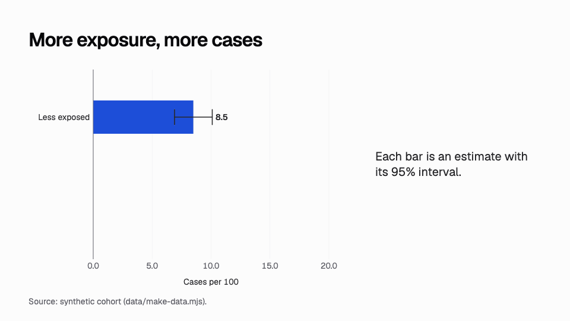

# stepdeck

*Step-by-step HTML presentations, written as data, that agents can build.*

[](https://github.com/horaciochacon/stepdeck/actions/workflows/ci.yml)

[Español](README.es.md)



[Live site](https://horaciochacon.github.io/stepdeck/) · [Gallery of every layout and component](https://horaciochacon.github.io/stepdeck/site/gallery/)

stepdeck is an engine for step-by-step HTML presentations. Slides are plain data: a layout, the elements in its regions, and a list of steps. The engine folds the steps into one state per step, components render the props of that state, and a command-line tool checks the deck at every step. A deck is static files with the engine copied in. It runs in Chrome with no build step, no CDN and no network at presentation time.

This page is the front door. It shows what you get, a quick start and one slide, then points deck authors, agent operators and contributors to the right page in [docs/](docs/index.md).

**Status.** First public release (0.1.0), with a [docs site](https://horaciochacon.github.io/stepdeck/site/docs/) and a [gallery](https://horaciochacon.github.io/stepdeck/site/gallery/). The built-in kit has 13 components and 5 layouts. The default theme is `modern`, and `academic-light` is the plain alternative; see the [changelog](CHANGELOG.md). PDF export is not implemented.

## What you get

| Piece | What there is | Reference |
|---|---|---|
| Components | 13: `text`, `chart.line`, `chart.bar`, `chart.points`, `terminal`, `markdown`, `big-number`, `list`, `diagram`, `chat`, `timeline`, `image`, `map`. Anything else is a custom component under the same contract. | [Components](docs/reference/components/index.md) |
| Layouts | 5: `title`, `figure-notes`, `full-bleed`, `statement`, `halves` | [Layouts](docs/reference/layouts.md) |
| Themes | 2: `modern` (the default: Geist, a deep blue accent, a large cover title) and `academic-light`, with color-vision-safe palettes and vendored fonts | [Themes](docs/reference/themes.md) |
| Shells | 2: `reveal` for presenting (keyboard, presenter view), `bare` for the CLI checks | |
| CLI | 9 commands: `help`, `new`, `new-component`, `catalog`, `serve`, `validate`, `dump`, `check`, `shoot` | [CLI](docs/reference/cli.md) |

## Quick start

You need:
- Node 20 or later;
- `npm install` in this repository, for Ajv (only `validate` needs it);
- Chrome plus Playwright for the browser commands (`check`, `dump`, `shoot`). Playwright is not a dependency: install it where Node can find it, or set `STEPDECK_PLAYWRIGHT` to a `playwright` package folder.

Then:

```sh
git clone https://github.com/horaciochacon/stepdeck.git
cd stepdeck
npm install
node cli/index.js new ../my-talk       # a working three-slide deck, engine copied into my-talk/stepdeck/
node cli/index.js serve ../my-talk     # prints a URL; open it in Chrome
```

In the presentation, the arrow keys or space step through, `S` opens the presenter view, and the URL hash `#/<slide>/<step>` addresses any step.

Check your work:

```sh
node cli/index.js validate ../my-talk          # in Node: schemas, props at every step, data, paths
node cli/index.js check ../my-talk --played    # in Chrome: layout, fonts, contrast, errors, played vs jumped
node cli/index.js shoot ../my-talk             # a PNG per step in my-talk/shots/960/
```

The full walk-through is in the [quick start guide](docs/guide/quickstart.md).

## A slide

This is `slides/chart.js` from the `talk` template that `new` copies:

```js
export default {
  id: "chart",
  layout: "figure-notes",
  title: "Group B overtakes Group A after 2020",
  elements: [
    { id: "chart", region: "main", type: "chart.line",
      props: { data: "data/series.csv", x: "year", y: "value", series: "group",
               series_shown: ["Group A"],
               axes: { x: "Year", y: "Indicator per 1,000" },
               format: { x: "d", y: ",.0f" } } },
    { id: "note", region: "notes", type: "text", from: "mark",
      props: { role: "note", text: "From 2020 on, Group B rises three times faster than before." } },
    { id: "latest", region: "notes", type: "big-number", from: "latest",
      props: { value: "{{data/summary.json#/latest_b}}", format: ",.1f", label: "Group B in 2024, per 1,000" } },
    { id: "source", region: "footer", type: "text", props: { role: "source", text: "Source: synthetic example data (data/make-data.mjs)." } },
  ],
  steps: [
    { id: "base", notes: "Start with one series." },
    { id: "compare", set: { chart: { series_shown: ["Group A", "Group B"] } } },
    { id: "mark", set: { chart: { annotate: [{ x: 2020, label: "2020" }] } } },
    { id: "latest", only: { chart: { highlight: "Group B" } }, notes: "Land on the figure." },
  ],
};
```

Each step patches the state of the step before, so any step can be reached directly and looks the same as playing up to it. The big number comes from a data file through a `{{file#/pointer}}` binding, so no figure is typed by hand.

Build your own in [Your first deck](docs/guide/first-deck.md); the rules for steps are in [The step model](docs/guide/step-model.md).

## Documentation map

| Page | For |
|---|---|
| [docs/index.md](docs/index.md) | The start of the docs: every page, by audience |
| [Guides](docs/index.md#guides) | Deck authors: quick start, first deck, step model, data, layouts, presenting, checking, custom components |
| [Reference](docs/index.md#reference) | Deck and slide spec, components, layouts, themes, CLI, rules, runtime API, component contract |
| [Concepts](docs/concepts/architecture.md) | How the pieces fit: fold engine, slide controller, layout renderer, registry, shells, CLI |
| [Contributing](docs/contributing/index.md) | Working on the engine: setup, tests, adding components, layouts, themes and rules |
| [Troubleshooting](docs/troubleshooting.md) | Common errors and what to do about them |

## For agents

The [skill](skill/SKILL.md) teaches an agent the whole workflow without reading engine source: catalog, slide spec, `validate`, `check`, `shoot` or `dump`, look, fix. Its `references/` cover the step model, components, custom components, themes and layouts, every check rule, and a cookbook. The repository is also a Claude Code plugin (`.claude-plugin/plugin.json`), which loads the skill; load it with `claude --plugin-dir /path/to/stepdeck`. Any other agent can read `skill/SKILL.md` directly.

The docs and the skill agree. To run agents on stepdeck, start with [stepdeck for agents](docs/guide/for-agents.md).

## Repository layout

- **Engine** (copied into every deck): `engine/`, which holds `core/`, `components/`, `layouts/`, `themes/`, `vendor/` and `schema/`.
- **Tooling:** `cli/` (the command line), `templates/` (the starter deck and the component skeleton), `skill/` (the agent skill; `.claude-plugin/` publishes it as a plugin).
- **Site and examples:** `index.html` (the landing page), `site/` (the docs viewer and the gallery), `examples/` (two example decks).
- **Docs:** `docs/`.
- **Development:** `test/` (unit and browser tests, fixtures), `.github/` (CI, contributing and security notes, issue and pull request templates).

Paths in backticks such as `core/fold.js` or `components/<name>/` are relative to `engine/`, which is also the layout of a deck's `stepdeck/` folder. The [repository tour](docs/contributing/index.md#repository-tour) describes every folder, including the generated ones.

## Contributing

Read [Contributing](docs/contributing/index.md) for setup, the tests and how to add a component, layout, theme or rule.

## Licence

MIT. See [LICENSE](LICENSE).

## Third-party notices

stepdeck vendors the following. Each library keeps its licence file in its `vendor/` folder, and each font its `OFL.txt` in its font folder:
- reveal.js (MIT), whose notes plugin bundles a copy of marked (MIT), covered by `vendor/marked/LICENSE`;
- d3 7.9.0 (ISC), with sub-notices for ColorBrewer, d3-ease, d3-geo (with GeographicLib), Delaunator and internmap;
- marked 18.2.1 (MIT);
- the Geist, Geist Mono, Source Sans 3 and IBM Plex Mono fonts (SIL Open Font License 1.1).

The palettes cite Okabe and Ito (2008), viridis (CC0) and ColorBrewer. Details are in [THIRD_PARTY_NOTICES.md](THIRD_PARTY_NOTICES.md).
