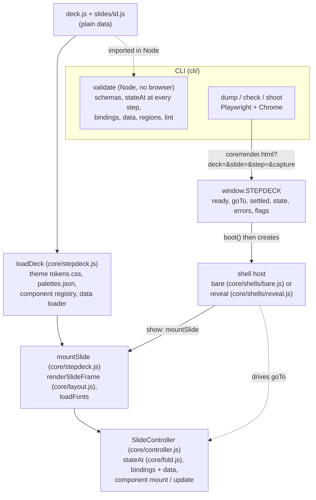

# Architecture

This page explains how stepdeck's pieces fit together. A slide spec is plain data. The engine folds its steps into states, a controller applies those states to components inside a layout frame, and a shell puts the frame on screen. Two CLI commands check the result: `validate` runs in Node, `check` runs in a browser.

It is for contributors who change the engine and for authors who want to know what happens under their slides. To write decks, start with the [guides](../index.md#guides). Agents should work from the [skill](../../skill/SKILL.md), not from this page.

## Principles

| Principle | What it means in the code |
| --- | --- |
| **Slides are data.** | A slide file exports an object with `layout`, `elements` and `steps`. It has no code that runs at show time: `validate` imports every slide file in plain Node, with no DOM. Anything that needs code is a component. |
| **State is a pure fold.** | `core/fold.js` has no imports, no DOM and no I/O. `stateAt(slide, k)` folds steps `0..k` over the initial elements and returns the state at step k. The runtime and `validate` call the same function. |
| **Jump equals play.** | Components render props. `update(props, info)` must reach the same final DOM whether the step was jumped to or played forward. Only a move forward by exactly one step animates. `check --played` compares the two paths. |
| **Same-origin, offline.** | The engine is copied into the deck (`<deck>/stepdeck/`) and libraries are vendored in `vendor/`. `boot()` refuses a deck on another origin. The CLI's browser blocks every request that does not go to its local server. |
| **Checks measure the real render.** | `check`, `dump` and `shoot` load the same `core/render.html` and runtime that a talk uses, in Chrome, and measure after `document.fonts.ready` and `STEPDECK.settled()`. Nothing is simulated. |

## The pieces at a glance

The arrows outside the CLI box are the runtime, in the browser; the dotted "drives goTo" line is control, not data. `boot()` sets `window.STEPDECK` first and creates the shell host; the host's `show()` calls `mountSlide`, which builds the `SlideController`, and every `goTo` then reaches the controller through the host. `validate` reads the same spec files in Node and calls the same `core/` modules (`fold.js`, `bindings.js`, `data.js`, `registry.js`, `format.js`). The browser commands drive the bare shell through `window.STEPDECK`.

## From spec to screen

1. **Boot.** A page calls `boot({ shell, deckUrl })` from `core/stepdeck.js`. It sets `window.STEPDECK` synchronously, before anything is awaited, and reads the query flags (`slide`, `step`, `capture`, `motion`, `lang`, `theme`, `receiver`).
2. **Load the deck.** `loadDeck` imports `<deck>/deck.js` first, since it names the theme and the slides. Then, in parallel, it imports every `slides/<id>.js` and fetches the engine's `themes/<theme>/tokens.css` and the optional `themes/<theme>/theme.css` (with `url()`s rebased to the theme folder), `themes/<theme>/palettes.json` and `components/index.json`. It builds the component registry, the data loader, the locale formatter, `t()` and `palette(kind)`. A slide file that fails to import becomes an error on that slide only.
3. **Mount a slide.** The shell calls `mountSlide(env, id, { attach })`. It loads `layouts/<layout>/layout.css` and `schema.json`, then calls `renderSlideFrame` to build the 1920 x 1080 canvas: one `div.sd-region` per region in the layout schema and one `div.sd-el` per element, with the layout's `kind` as `data-kind` and its hook classes (`sd-title`, `sd-subtitle`, …) on the regions and elements they name. Styles are cascade layers, lowest first: `sd-core`, `sd-layout`, `sd-theme`, `sd-deck` (declared and empty, reserved for per-deck overrides), `sd-slide` (see [Themes](../reference/themes.md#cascade-layers)). The frame is attached to the document while still hidden (`.sd-booting`), so components can measure it. Every font face the theme declares is loaded before any component runs, and the theme tokens are read into `ctx.tokens`.
4. **Run the controller.** `mountSlide` creates `new SlideController({ slide, registry, ctxBase, mountPoint })`; the constructor only stores its arguments. The shell's first `goTo(step)` mounts every element, hidden ones included, with its step-0 resolved props, then folds the slide to that step, resolves bindings and calls `update` on each component.
5. **Show it.** After the first `goTo`, the frame drops `.sd-booting`. The bare shell scales the canvas to fit the window. The reveal shell puts it inside a reveal `<section>`.

`mountSlide` never throws. A missing layout, an unknown region, a font that fails to load, a fold error or any other exception ends as an on-canvas error and a line in `STEPDECK.errors`.

## Module map

### `core/`

The runtime. Everything here runs in the browser. Modules marked "Node too" are also imported by the CLI.

| Module | Role |
| --- | --- |
| `stepdeck.js` | `boot()`, `loadDeck`, `mountSlide`, the navigation queue, `readFlags` and `window.STEPDECK`. Holds the bare shell host (`createBareHost`). |
| `constants.js` | `CANVAS` (1920 x 1080), `DEFAULT_THEME`, `DEFAULT_LAYOUT` (`full-bleed`). Node too. |
| `fold.js` | The pure fold: `stateAt`, `stepIndex`, `stepCount`, `expandSugar` (`from`, `at`, `advance`), `mergePatch`, `initialElements` (the slide `title` and `section` sugar), `parseStepRef`. Node too. |
| `accent.js` | The accent phrase in titles: `parseAccent`, `stripAccent`, `escapeAccent`, `accentMarks`. Pure; the `text` component, the reveal placeholder, `dump` and `validate` share it. |
| `controller.js` | `SlideController`: mount, `goTo`, abort, watchdog, `ctx` (including `ctx.mount` for nested components and `ctx.motion`), error recording. On an animating step it holds entering elements to their stagger slot and asks the frame to move their boxes. Runs without a DOM. |
| `layout.js` | `renderSlideFrame`: canvas, regions, element boxes, visibility classes, ghost placeholders, box entrances and exits (`enterBox`, `exitBox`), error boxes, scoped `slide.style`, `slide.regions` variables. |
| `registry.js` | `createRegistry`: resolves a component name to its module and schema, deck components first. Did-you-mean on unknown names. Node too. |
| `bindings.js` | `{{path#pointer \| format}}` resolution in props. Node too. |
| `data.js` | The data loader (JSON, GeoJSON, CSV), path rules, CSV parsing and typing, caching. The caller injects `read`. Node too. |
| `format.js` | `makeFormat(lang)`: d3-format with the deck's locale (`en`, `es`). Node too. |
| `i18n.js` | `t(lang, key)` for the few engine strings. |
| `animate.js` | `ctx.animate`: `fadeIn`, `reveal`, `drawPath`, `tween`, `stagger`. All abort-aware; they settle at the end state when aborted. |
| `motion.js` | The named motions (`fade`, `rise`, `wipe`, `pop`, `draw`, `none`), `parseEase`, the theme timing (`timing`: `--sd-duration`, `--sd-easing`, `--sd-stagger`, overridden by a step's `transition`) and `makeMotion(tokens)`, which is `ctx.motion`. Writes only `opacity`, `transform` and `clip-path` and puts them back. The frame moves element boxes with it; components move their parts. |
| `choreography.js` | Pure rules for a step's entrances and exits: which system plays an entrance (`resolveEntrance`: the box, or a component with `"x-enter": "own"`), the exit (`resolveExit`), and the stagger slots (`slotDelays`). Used by the controller. Node too. |
| `kit.js` | Small shared helpers for the engine and components (`message`, `escapeHtml`, `memoAsync`, `motion`, `motionMs`, `focusPaint`, `tweenColor`, SVG and measuring helpers). |
| `chart.js` | Helpers shared by `chart.line` and `chart.bar` (`loadTable`, tick formats). |
| `color.js` | WCAG 2 color math (`parseHex`, `luminance`, `contrast`). Node too: the CLI uses it for palette and contrast checks. |
| `inline.js` | `renderBlock` and `renderInline`: sanitized Markdown through the vendored marked. |
| `d3.js` | One accessor for the vendored d3 bundle that works in Node and the browser. |
| `stepdeck.css` | Structural CSS and the default rules of the styling hooks (title, kicker, accent, subtitle, meta, statement, cover), in the `sd-core` layer: canvas, regions, hidden and collapsed elements, error boxes, text roles, `html.capture` (no transitions). Colors, fonts and sizes come from theme tokens. |
| `render.html` | The bare shell page: `render.html?deck=<dir>&slide=&step=&capture`. `deck` defaults to `../../`, the deck folder when the engine is copied to `<deck>/stepdeck/`. |
| `shells/bare.js` | `createBareShell`: one canvas on a stage, scaled to fit and letterboxed. |
| `shells/reveal.js`, `shells/reveal.css` | `createRevealHost`: the presenting shell on top of the vendored reveal.js. |

### `cli/`

Dev tooling. Nothing here is needed to present.

| Module | Role |
| --- | --- |
| `index.js` | The `stepdeck` bin: argument parsing, the commands, exit codes, `--json`. |
| `validate.js` | `validate`: the deck checked in Node, at every step, with no browser. |
| `check.js` | `check` and `check --played`: layout rules, page errors, played-vs-jumped comparison. |
| `dump.js` | `dump`, plus the browser session (`withDeck`) that `check` and `shoot` share. |
| `shoot.js` | `shoot`: one PNG per step. |
| `browser.js` | Playwright loading, the local server, the offline guard, `deckTarget` (which folder to serve and the bare shell URL). |
| `serve.js` | Static server with `Cache-Control: no-store`. |
| `catalog.js` | `catalog`: the index of components, layouts and themes that agents read. |
| `new.js` | `new` (copy a template and the engine) and `new-component`. |
| `engine.js` | The two roots, `ENGINE` (`<repo>/engine`) and `REPO` (the repository root); finds the engine a deck uses (`<deck>/stepdeck/` or `ENGINE`); shared file helpers. |
| `problems.js` | The `Problem` shape and the one-line formatter every command uses. |
| `palettes.js` | Palette contrast and color-vision checks. |
| `ajv.js` | The one Ajv setup (draft 2020-12, strict). Only `validate` loads it. |

## Lifecycle of a navigation

Every move, from a key press in reveal or from the CLI, goes through `STEPDECK.goTo(slide, step)`.

1. **The host may refuse.** The reveal host's `navigated(slide, step)` checks the target. For an unknown slide or step it records `stepdeck: unknown …` in `STEPDECK.errors` and returns `false`, and nothing moves. Otherwise it writes the URL hash and moves reveal to match. The bare host has no such check.
2. **Same slide: straight to the controller.** When the target is the slide on screen and no slide change is queued, `goTo` calls that slide's `goTo(step, { animate })` directly. A new step can then supersede an animation that is still running instead of waiting for it.
3. **Other slide: queued.** A slide change is chained on one promise (`nav`), so slide changes apply in order. The host's `show(slide, step)` runs:
   - bare: destroy the current slide, mount the new one, `goTo(step)` with no animation;
   - reveal: mount the slide if it is not mounted yet, pause the slide it leaves, start mounting its neighbours (±1), and `goTo(step)` with no animation.
   An exception here is recorded as `stepdeck: <message>`.
4. **The controller queues and aborts.** `SlideController.goTo(ref)` resolves the step ref with `stepIndex`. An unknown ref rejects at once, and `mountSlide` records it as a slide error. A known ref becomes the single pending target, replacing any earlier one, and the signal of the step being applied is aborted. One loop drains the queue: it waits for the mount, then applies the latest pending target. Targets in between are dropped.
5. **Apply a state.** For the target index the controller calls `stateAt`, resolves bindings for every live element and drops the target if it was superseded meanwhile. Then, per element:
   - `setVisible` when its visibility changed;
   - `update(props, info)` when its resolved props or its visibility changed (deep compare). The first `goTo` after mount updates every element, with `prev: null` and `animate: false`.
   `info.animate` is true only when animation was asked for and the target is exactly one step after the last applied step. `STEPDECK.flags.animate` asks for it unless the page is in capture mode, is a presenter preview frame (`?receiver`), or has reduced motion without `?motion=full`. Elements update in parallel. Each gets its own `AbortSignal`, linked to the step's signal.
   On an animating step, elements that change visibility move (`core/choreography.js`): an entering element is held until its stagger slot, then shown and updated in one synchronous block while its box plays its entrance (`enterBox`), or the component builds itself when it declares `"x-enter": "own"` (`info.entrance`); a leaving element plays its out motion (`exitBox`) and is hidden when it ends. Abort releases every held element at once. See [Animation and motion](../guide/animation-and-motion.md#choreography-within-a-step).
6. **Settle.** `STEPDECK.settled()` waits for the navigation queue, then for the host's pending work (reveal: neighbour prefetches), then for the controller's loop. It waits for every element's update, hidden ones included.

### Errors along the way

| Where | What happens | Message |
| --- | --- | --- |
| Deck load | Fatal: an error canvas, `ready` still resolves. | `deck: cannot load <url>: …`, `deck: deck must be same-origin with the page …` |
| Theme, palettes, `components/index.json` | Recorded; the deck goes on without them. | `deck: theme '<t>' not found (…)` and similar |
| Slide file, layout, font, fold, unknown step | Slide error, on that slide's canvas only. | `<slide>: <message>` |
| Unknown component, binding, `mount` or `update` throws | Element error, shown in the element's box. The element stays visible and gets no further calls. | `<slide>/<element>: <message>` |
| `mount` or `update` does not settle in 10 s | The watchdog fails the element and aborts its signal. The slide goes on. | `<slide>/<element>: did not settle within 10s` |

`goTo` and `ready` never reject. `STEPDECK.errors` holds the boot errors plus the errors of the slide on screen. In reveal, a neighbour's errors appear once you navigate to it.

## Two shells

Both shells share `boot()`, the query flags, `mountSlide`, the navigation queue and `window.STEPDECK`. They differ in what is mounted and who drives navigation.

| | Bare shell | Reveal shell |
| --- | --- | --- |
| Page | `core/render.html` | the deck's `index.html` (`boot({ shell: "reveal" })`) |
| Mounted | One slide; destroyed when another is shown | The current slide and its neighbours (±1); the slide left is paused; slides are destroyed only on `pagehide` |
| Navigation | Only `STEPDECK.goTo` | Keyboard, presenter view, overview, and the `#/<slide>/<step>` hash, all turned into `STEPDECK.goTo` |
| Used by | Every CLI browser command, and most browser tests | Presenting, and the reveal browser tests (`test/browser/reveal.test.mjs`, `test/browser/hanging.test.mjs`) |

The bare shell exists so that a step can be shown with nothing else involved: one fresh page, one slide, one fold, one `update`. That makes a page load at `?slide=&step=` a true jump, which is what `check --played` compares against. It also keeps reveal.js out of every measurement. `core/shells/reveal.css` undoes reveal's own styles on the canvas, so a slide looks the same in both shells.

How the CLI uses it (`cli/browser.js`, `cli/dump.js`):

1. `deckTarget` picks the folder to serve: the deck itself when it has an engine copy in `<deck>/stepdeck/`, otherwise the engine repo, but only for decks inside the repo (examples, fixtures). Any other deck is refused.
2. `cli/serve.js` serves it on `127.0.0.1`. Chrome is launched through Playwright (`STEPDECK_PLAYWRIGHT`, `STEPDECK_CHANNEL`), and every request to another origin is aborted and recorded.
3. Each step is a fresh load of `core/render.html?deck=<dir>/&slide=<id>&step=<n>&capture`. The harness waits for `STEPDECK.ready`, `document.fonts.ready` and `STEPDECK.settled()`, then measures.
4. `check --played` loads without `capture` and with `?motion=full`, then calls `STEPDECK.goTo` to arrive at each step from the step before (animated) and from the step after. It stops with an error if `STEPDECK.flags.animate` is not `true`, so the animated path never silently turns into a jump.

## Where validation happens

The same mistake can be caught at three points: `validate` in Node, the runtime on the canvas, and `check` in the browser.

| Concern | `validate` (Node) | Runtime | `check` (browser) |
| --- | --- | --- | --- |
| Deck, slide, layout and component schemas | Yes (Ajv) | No | No |
| Step refs, unknown elements, fold | `stateAt` at every step | Slide error | `render-error` |
| Unknown component or layout, unknown region | Yes, with did-you-mean | Element or slide error | `render-error` |
| Bindings, data files, CSV columns | Yes | Element error | `render-error` |
| Props against the component schema, at every step | Yes | No | No |
| A component that throws at render time | No | Element error | `render-error` |
| Text outside canvas or region, overlap, font size, contrast | No | No | Yes |
| Console errors, failed or remote requests | No | No | `console-error`, `network-error` |
| Played arrival equals jump | No | No | `check --played` |

The overlap is deliberate:
- **`validate` is fast and needs no browser.** It names the exact rule, the step and a fix, and it checks every step's resolved props against the component schema, which the runtime never does. It imports the same `core/` modules as the runtime, so a fold or binding it accepts behaves the same in the browser. It also imports `components/diagram/place.js`, so diagram placement problems are caught in Node too.
- **`check` sees what `validate` cannot.** Component code that throws on real data, layout geometry, fonts, contrast and network requests only show up in a real render. Whatever the runtime catches reaches `check` as `render-error`, so a gap in `validate` still fails the deck.

See [Checking a deck](../guide/checking-a-deck.md) for the workflow and [Rules](../reference/rules.md) for every rule.

## Design history

[`docs/design/2026-11-18-engine-design.md`](../design/2026-11-18-engine-design.md) is the approved plan. Passages changed after the M0 (spike) and M1 (usable core) milestones, defined in its §8, are marked **[M0]** and **[M1]**, and [`docs/design/m0-findings.md`](../design/m0-findings.md) gives the reason for each change. Read them for the why; trust the code and these pages for the what.

These parts of the design doc are stale:

| Section | What it says | What is true |
| --- | --- | --- |
| §9 shell interface | A shell has `goto(slide, step)`, `onChange` and `scale`. | A host is `{ current, show(slide, step), showFatal(root), initial?, navigated?(slide, step), idle?() }`. `boot()` keeps the navigation queue; the host decides what is mounted. |
| §6.2 escape-hatch example | `ctx.mount("map", el.appendChild(document.createElement("div")), …)` | There is no `map` component. Use a built-in from `components/index.json`, and create nodes with `el.ownerDocument`. See [Custom components](../guide/custom-components.md). |
| §6.3 `settled()` | Resolves "when every visible component has finished". | It waits for the navigation queue, the host's pending prefetches (reveal) and every element's update, hidden ones included. |
| §5, §9, §10 `pdf` command | `stepdeck pdf` renders one page per step. | Not built. The CLI has no `pdf` command. |
| §8 milestone table | `chart.bar`, `chat`, `image` and `list` in M2; `diagram` and `timeline` in M3. | All six shipped early, with the slide kit 1 work package (see the [changelog](../../CHANGELOG.md)), along with the `statement` and `halves` layouts. |
| §6.3, §6.4 marks and callouts | `mark` and `callout` elements placed with a component's `anchor()`. | Not built. Only `chart.line` implements `anchor()`, and nothing calls it yet. |

`m0-findings.md` B4 also lists `ctx` without `assetUrl`, which was added in M1. The full `ctx` is in [`core/controller.js`](../../engine/core/controller.js) (`#ctxFor`) and in [`schema/stepdeck.d.ts`](../../engine/schema/stepdeck.d.ts).

## Related pages

- [The step model](../guide/step-model.md): what the fold does with `set`, `replace`, `show`, `hide`, `only` and the shortcuts.
- [Animation and motion](../guide/animation-and-motion.md): when `info.animate` is true and how components honor it.
- [Presenting](../guide/presenting.md): the reveal shell from the presenter's side.
- [Runtime API](../reference/runtime-api.md): `boot()`, `window.STEPDECK` and the query flags in full.
- [Component contract](../reference/component-contract.md): `mount`, `update`, `info` and `ctx`.
