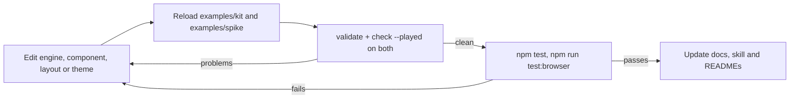

# Contributing

This page is for people who change stepdeck itself: the engine, the built-in components, layouts and themes, the CLI, the tests or the docs. It covers setting up the repository, what each folder is for, the loop you run while you work, and where to go for each kind of change. If you only want to write decks, start with the [Quickstart](../guide/quickstart.md) instead.

## Set up

You need:

| Tool | Version | Why |
| --- | --- | --- |
| Node | 20 or later (`engines` in `package.json`); 22.15 or later to run the test scripts | The CLI and the tests. The test scripts pass a glob (`'test/unit/**/*.test.mjs'`) to `node --test`, which Node 20 does not expand, and the no-Ajv test uses `registerHooks` from `node:module` (Node 22.15+). See [Testing](testing.md). |
| npm | any recent | Installs `ajv` (a dependency) and `marked` (a dev dependency, used only by the test that compares it with the vendored copy). In the CLI only `validate` uses Ajv; the unit tests (and one browser test) use it too, so run `npm install` before `npm test`. The runtime imports marked from `vendor/marked/`, never from `node_modules/`. |
| Chrome | current | `dump`, `check`, `shoot` and the browser tests drive the system Chrome through Playwright. `STEPDECK_CHANNEL` picks another channel; the default is `chrome`. |
| Playwright | 1.58.0 in CI | Not a dependency. `npm run playwright` installs the version CI pins into `node_modules` without saving it (a later plain `npm install` removes it again); or point `STEPDECK_PLAYWRIGHT` at a `playwright` package folder. Another recent version usually works, but CI is the reference. |

```sh
git clone <this repository> stepdeck
cd stepdeck
npm install
export STEPDECK_PLAYWRIGHT=/path/to/node_modules/playwright   # if Node cannot resolve playwright on its own
```

Check the setup with the unit tests, which need no browser:

```sh
npm test
```

All tests should pass in a few seconds; the last lines of the output give the totals. In the CLI only `validate` imports Ajv, and it does so lazily, so `help`, `new` and the browser commands work even before `npm install`.

## Repository tour

The engine is plain ES modules with no build step. Its runtime folders live in `engine/`, and `node cli/index.js new` copies them into each deck as `<deck>/stepdeck/`; the rest is development tooling and never ships with a deck.

Paths in backticks such as `core/fold.js` or `components/<name>/`, here and in the rest of the docs, are relative to `engine/`. That is also the layout of a deck's `stepdeck/` folder, so the same path works in both places. Markdown links point at the files in `engine/`.

Node code outside the engine (`cli/`, `test/`) imports engine modules through the `imports` field of `package.json`, as `import { stateAt } from "#engine/core/fold.js"`, and finds engine files with `ENGINE` (`<repo>/engine`) and `REPO` (the repository root) from [`cli/engine.js`](../../cli/engine.js). Browser code outside the engine (`site/`, the example decks) uses relative paths such as `../../engine/core/kit.js`.

| Folder | What it owns | Copied into decks by `new` |
| --- | --- | --- |
| `engine/core/` | The runtime: the fold engine (`fold.js`), the per-slide controller (`controller.js`), the layout renderer (`layout.js`), `boot()` and `window.STEPDECK` (`stepdeck.js`), the shells (`shells/bare.js`, `shells/reveal.js` with `shells/reveal.css`, plus `core/render.html` for the bare shell), the data loader, bindings, formats, i18n, the component registry and shared component helpers (`animate.js`, `motion.js`, `choreography.js`, `kit.js`, `accent.js`, `canvas.js`, `color.js`, `inline.js`, `d3.js`, the chart helpers `chart.js` and `chart-*.js`, and the map helpers `map.js` and `map-*.js`), constants and `stepdeck.css`. | yes |
| `engine/components/` | The 13 built-in components, one folder each with `schema.json`, `index.js`, `README.md` and `example.js`. `components/index.json` lists them and sets their order. | yes |
| `engine/layouts/` | The 5 built-in layouts, one folder each with `layout.css`, `schema.json`, `README.md` and `example.js`. | yes |
| `engine/themes/` | The built-in themes: `modern` (the default) and `academic-light`. Each has `tokens.css`, an optional `theme.css`, `palettes.json`, `README.md` and vendored fonts with their licences. | yes |
| `engine/schema/` | JSON schemas for the deck (`deck.schema.json`), slides (`slide.schema.json`) and layout descriptors (`layout.schema.json`), and `stepdeck.d.ts`: the deck spec and the component contract as TypeScript types. | yes |
| `engine/vendor/` | Vendored reveal.js, d3 and marked, each with its licence file. | yes |
| `cli/` | The command line (`index.js` is the `stepdeck` bin): `validate`, `check`, `dump`, `shoot`, `catalog`, `new`, `new-component`, `boundaries`, `serve`, and their shared helpers (`engine.js`, `browser.js`, `problems.js`, `palettes.js`, `ajv.js`, `png.js`). Also `serve-site.js` (`npm run site`), which serves the repository under `/stepdeck/`, as GitHub Pages does, to preview the site locally. | no |
| `templates/` | `talk`, the starter deck that `new` copies, and `component`, the skeleton that `new-component` copies. | no (`talk` becomes the deck itself) |
| `examples/` | Two decks that use `engine/` as their engine, with no copy: `spike`, the second example deck (line-chart morph, terminal with `advance`, the custom component `demo.story`) and `kit` (every layout and component of slide kit 1). | no |
| `skill/` | The agent skill: `SKILL.md` and `references/`. `.claude-plugin/plugin.json` publishes it as a plugin. | no |
| `test/` | `unit/` (plain `node:test`, no browser), `browser/` (Playwright) and `fixtures/` (`validate/`, `check/`, `decks/`, plus `boundaries/`, `fourth-layout/` and `no-title-layout/`). | no |
| `docs/` | Guides, reference, concepts, these contributing pages, and design history in `docs/design/`. | no |
| `site/` | The public site: `site.css` and `landing.js` for the landing page, `docs/` (the docs viewer, `viewer.js`, which renders the Markdown in `docs/` in the browser, and `flowchart.js`, which draws its mermaid flowcharts) and `gallery/` (a stepdeck deck with a slide for every layout and component). | no |
| `index.html` | The landing page of the public site. | no |
| `.github/` | `workflows/ci.yml`: a fast job (the unit tests and the site smoke test) that gates the Pages deploy, and the full browser suite on six parallel runners as the status check. Also `CONTRIBUTING.md` and `SECURITY.md` (what GitHub shows contributors and security reporters), the bug report form in `ISSUE_TEMPLATE/` and `pull_request_template.md`. | no |

`LICENSE` and `THIRD_PARTY_NOTICES.md`, at the repository root, are copied into every deck along with the engine folders.

### Generated folders

These are written by the CLI or by tools and are listed in `.gitignore`. Never commit them, and do not edit them by hand:

| Path | Written by |
| --- | --- |
| `node_modules/` | `npm install` |
| `shots/` (anywhere, for example `examples/kit/shots/`) | `shoot`: one PNG per step under `shots/<size>/`. Files are overwritten, but stale ones are never deleted. |
| `catalog/` | `catalog`. Run with no deck from the repo root, it rewrites `<repo>/catalog/` and removes stale `*.json` there first. |
| `.superpowers/`, `docs/superpowers/` | Local agent working files, plans and specs (the superpowers skills write them here). Git-ignored, so they are never committed or published. |

## Development loop

The two example decks are your baselines. Their `index.html` maps the engine to the repository's `engine/` folder instead of to a copy:

```html
<script type="importmap">{ "imports": { "stepdeck/": "../../engine/" } }</script>
```

A deck made by `new` has `"./stepdeck/"` there; that line is the only functional difference (apart from the `<title>` and a comment). So any change you make in `engine/` (`core/`, `components/`, `layouts/` or `themes/`) shows up in the examples with no copy step.

Run both examples while you work. Each `serve` needs its own port (the default is 8000), so give the second one `--port 0`:

```sh
node cli/index.js serve examples/kit       # prints a URL such as http://127.0.0.1:8000/examples/kit/
node cli/index.js serve examples/spike --port 0   # picks a free port and prints its URL
```

`serve` sends `Cache-Control: no-store`, so a reload picks up your edits.

Both decks are clean today. Keep them clean:

```sh
node cli/index.js validate examples/kit         # validate: 10 slides, 0 errors, 0 warnings
node cli/index.js check examples/kit --played   # check: 10 slides, 28 steps, 36 played arrivals compared, 0 problems
node cli/index.js validate examples/spike       # validate: 5 slides, 0 errors, 0 warnings
node cli/index.js check examples/spike --played # check: 5 slides, 18 steps, 26 played arrivals compared, 0 problems
```

A problem that appears after your change is a regression, either in your change or in a rule you added. `test/browser/kit.test.mjs` asserts that the kit deck stays clean under `validate`, `check` and `check --played`, and several browser tests use the second example deck (`examples/spike`).

To look at the result, `node cli/index.js shoot examples/kit` writes PNGs to `examples/kit/shots/960/`, and `node cli/index.js dump examples/kit --slide <id>` prints every element's box, text and visibility per step.

Before you finish, run both test suites:

```sh
npm test
npm run test:browser    # needs Chrome and Playwright (`npm run playwright` installs the version CI uses)
```

`npm run test:all` runs one after the other. How the tests are organized, and how to run one file, is in [Testing](testing.md).



## Where to make changes

| You want to | Read |
| --- | --- |
| Add a built-in component (schema with `x-transition` annotations, motion, README, example, tests) | [Adding a component](adding-a-component.md) |
| Add a layout (`layout.css`, `schema.json`, README, example) | [Adding a layout](adding-a-layout.md) |
| Add a theme (`tokens.css`, `palettes.json`, fonts, README) | [Adding a theme](adding-a-theme.md) |
| Add a `validate` or `check` rule and its fixture | [Adding a rule](adding-a-rule.md) |
| Write or run unit and browser tests | [Testing](testing.md) |
| Follow the code, naming, error-message and docs conventions | [Conventions](conventions.md) |

For how the runtime pieces fit together (fold, controller, layout renderer, registry, shells, CLI), see [Architecture](../concepts/architecture.md). Deck-level custom components, which live in a deck rather than in the engine, are covered in [Custom components](../guide/custom-components.md).

## Keep the docs in sync

The same facts are written down for three readers, and a change is not done until all three agree with the code:

| Where | Reader | Update when |
| --- | --- | --- |
| `docs/` (guides, reference, concepts, contributing) | People | Any behavior, prop, flag, rule, layout or theme changes. |
| `skill/SKILL.md` and `skill/references/` | Agents building decks | The same changes. Agents are told not to read engine code, so the skill must be complete on its own. |
| `components/*/README.md`, `layouts/*/README.md`, `themes/*/README.md`, and each `schema.json` description | Both, through `catalog` | The piece itself changes. `catalog` serves these files to agents, so a stale README is a wrong answer. |

Also update `schema/stepdeck.d.ts` when the spec or the component contract changes, and `README.md` together with `README.es.md` when the front page changes (the two mirror each other section for section).

Do not update design history retroactively. `docs/design/` records what was planned and decided at the time. When the code moves on, change the user docs and leave those files as they are; the [docs index](../index.md#design-history) already says the code and the user docs win where they disagree.
