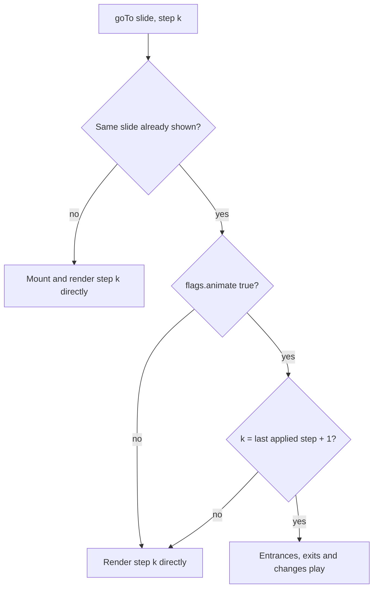

# Animation and motion

This page explains how things move in a stepdeck talk: when a step change plays motion, the named motions that elements enter and leave with, how the entrances of one step follow each other, the theme tokens that set the timing, and the four slide devices built on them (focus-dim, the message line, badges and ghost placeholders). It also covers how reduced motion and screenshots turn motion off, and how to check that a played step ends exactly where a jump to it ends.

It is for two readers:

- **Deck authors**, who write slides by hand and want to know what the audience will see.
- **Component authors**, who write a component's `update()` and must keep the played-equals-jumped rule.

Agents writing decks should follow the [step model reference](../../skill/references/step-model.md), the [cookbook](../../skill/references/cookbook.md) and the [checks reference](../../skill/references/checks.md) in the skill. Everything below comes from the engine code: `core/motion.js` (the named motions and their timing), `core/choreography.js` (which system plays an entrance), `core/controller.js` (when things move), `core/layout.js` (the element boxes), `core/kit.js`, `core/stepdeck.js` and the built-in components.

The [gallery](../../site/gallery/) has five motion slides that show everything on this page: `motion-names`, `motion-choreography`, `motion-focus`, `motion-message` and `motion-ghost` (their files are in [`site/gallery/slides/`](../../site/gallery/slides/)).

## The rule: played equals jumped

A slide's look at step *k* depends only on step *k*. Motion is decoration on the way there. When a step finishes playing, or when it is cut short, the page must match exactly what you get by opening step *k* directly. The engine's box motions put back exactly the inline styles they touched, and every built-in component writes its full target state at the end of `update()` and removes the inline styles its motion used. That is why a screenshot, a jump in the presenter view and a step played live all show the same slide.

## When motion plays

Only one kind of move animates: a **forward move of exactly one step from the last step that was applied** on the slide. Every other move renders the target state directly:

| Move | Animates? |
|---|---|
| First load of a slide (page load, slide change, reveal pre-mounting a neighbour) | No |
| Forward by one step (k to k+1) | Yes, if motion is on (see [below](#reduced-motion-capture-and-preview-frames)) |
| Forward by two or more steps | No |
| Backward, by any number of steps | No |
| Jump on the same slide by id or number (`STEPDECK.goTo`, a hash change in reveal) | Only if the target happens to be the next step after the one applied |

The engine decides this in the slide controller (`core/controller.js`), not in the components. It passes the decision to every changed element as `info.animate`:

```js
animate: animate && appliedIndex !== null && index === appliedIndex + 1
```

`animate` is the shell's request, which is `STEPDECK.flags.animate`, withheld while the page is hidden (see [Hidden pages](#hidden-pages)). `appliedIndex` is the step the slide currently shows. It is `null` before the first step is applied, so the first render never animates.



When a move does not animate, nothing is held for a stagger slot either: every element is shown or hidden at once and every component renders its end state.

Only elements whose resolved props or visibility changed get an `update()` call. An element that is the same at both steps is left alone, so a no-op step plays nothing.

### Interrupting motion

A new navigation aborts the motion in flight. Each element's `update()` gets an `AbortSignal` in `info.signal`. When the presenter presses the next key during a motion, the engine aborts that signal: every element still waiting for its stagger slot appears at once, every box motion and every `ctx.animate` or `ctx.motion` helper jumps straight to its end state and resolves. The engine then applies only the latest requested step. Steps requested in between are skipped. Pressing next quickly therefore lands on the right slide state; it does not queue up animations.

## The named motions

Every entrance and exit uses one shared vocabulary of named motions (`core/motion.js`). Each name has an **in** (the element arrives) and an **out** (it leaves). A motion writes only `opacity`, `transform` and `clip-path`, and when it ends it puts those three back exactly as it found them, so an element placed with a canvas `box` keeps its inline `left`, `top`, `width` and `height`.

| Name | In | Out |
|---|---|---|
| `fade` | Opacity 0 to 1. | Opacity 1 to 0. |
| `rise` | Fades in while moving up into place from `--sd-motion-distance` below. | Fades out while moving up by the same distance. |
| `wipe` | Revealed from left to right (`clip-path`). | Clipped away from the right edge back to the left. |
| `pop` | Fades in while scaling from 0.92 to 1, with a slight overshoot. | Fades out while shrinking to 0.96. |
| `draw` | The component's own build, when it has one (see [Which system plays an entrance](#which-system-plays-an-entrance)); on a plain box, a `wipe`. | A `fade` out: a build has no reverse. |
| `none` | Appears at once. | Disappears at once. |

Every motion eases with the theme's `--sd-easing` (the components' builds and changes too; only typing runs at a constant speed), lasts the theme's `--sd-duration` unless something sets another duration, and jumps to its end state on abort or when its duration is 0. A name that is not in the list is a `validate` error with a did-you-mean (`"rize"` suggests `"rise"`).

## How an element enters and leaves

An element **enters** on a step where it becomes visible (through `from`, `at` or `show`) and **leaves** on a step where it becomes hidden. On an animating step the engine moves the element's box (`div.sd-el`) for it, so every component, custom ones included, gets an entrance and an exit without writing any motion code.

### `enter` and `exit`

Both keys take a motion name, or an object that adds timing in milliseconds:

```js
{ id: "note", type: "text", props: { text: "Rises in, half a second after its slot" },
  from: "more", enter: { motion: "rise", delay: 500, duration: 600 } },
{ id: "aside", type: "text", props: { text: "Leaves without motion" }, at: ["base"], exit: "none" },
```

| Key | Default | Meaning |
|---|---|---|
| `enter` | the theme's `--sd-enter` (`rise` in `modern`, `fade` in `academic-light`), or the component's own build | How the element arrives. |
| `exit` | `fade` | How the element leaves. |
| `motion` (object form) | | The motion name. Required in the object. |
| `delay` (object form) | 0 | Milliseconds added to the element's stagger slot. **Entrances only**: an exit always starts at once. 0 to 5000. |
| `duration` (object form) | the step's duration | Milliseconds the motion lasts, for an entrance and for an exit. It wins over a non-zero `transition.duration` on the step. 0 to 5000. |

A step whose duration is 0 (`transition: { duration: 0 }`, or a theme with `--sd-duration: 0ms`) snaps everything, an element's own `delay` and `duration` included.

`enter: "none"` and `exit: "none"` turn motion off for that element. A theme whose `--sd-enter` is `none` turns off the box entrances of a whole deck; components that build their own entrance (below) still build unless their element says `enter: "none"`. Entering elements still take their stagger slots, so they appear one stagger apart; `--sd-stagger: 0ms` removes the stagger hold (an element's own `delay` still applies).

The box motion writes inline `opacity`, `transform` and `clip-path` on the element's box (`div.sd-el`) while it plays, and puts back what was there when it ends. Inline styles beat a slide's `style`, so a rule there that sets one of those three properties on the element box (`[data-el="card"] { opacity: 0.6 }`) does not apply during the entrance or exit and then jumps in. Style a node inside the box instead (`[data-el="card"] .sd-markdown { opacity: 0.6 }`). Other properties of the box, such as its padding, border or background, are not touched.

### Which system plays an entrance

Exactly one thing moves when an element enters: its box, or the component inside it, never both.

A component whose content has a natural build declares `"x-enter": "own"` at the top of its `schema.json`. On its entrance it replays that build from empty to the state of the step, while its box stays still. `stepdeck catalog` shows it as `enter: own`. The built-ins that own their entrance:

| Component | Its build |
|---|---|
| `chart.line` | The lines draw along their length. |
| `chart.bar` | The bars grow from zero, then the whiskers draw. A waterfall grows out of zero as a whole. |
| `chart.points` | The dots grow out of the reference value (out of their `from`, for a pair; 0 or the start of the axis when the reference is not on the axis) and their whiskers draw; strips fade in from left to right. |
| `big-number` | The figure fades in and counts up from 0. |
| `list` | The visible items rise in, one after another; done ticks draw. |
| `chat` | The visible messages rise in, one after another; with `typing`, the newest is then typed. |
| `diagram` | Groups fade in, then nodes pop in one after another, then edges draw. |
| `terminal` | With `typing`, the command is typed; then the log lines fade in, one after another. |
| `timeline` | The track fills from the start to `progress`, then the `current` stop grows. |

`text`, `markdown` and `image` do not own their entrance: their box moves.

The engine resolves `enter` like this (`core/choreography.js`):

| Element | `enter` | What plays |
|---|---|---|
| Component without `x-enter: own` | unset | The box plays the theme's `--sd-enter`. |
| Component without `x-enter: own` | a name | The box plays that name (`draw` plays a `wipe`). |
| Component with `x-enter: own` | unset or `draw` | The component builds itself; the box stays still. |
| Component with `x-enter: own` | `fade`, `rise`, `wipe` or `pop` | The box plays that name; the component shows its content at once. |
| Any | `none` | Nothing: the element appears at once. |

The theme's `--sd-enter` applies only to components that do not own their entrance: a chart draws itself in both built-in themes.

Because an owned build already goes from empty to the state of the step, items that a step reveals together with the element are part of the entrance. A list that appears with `shown: 3` plays one build of three items; you do not need to reveal its items on a later step to see them move.

### Exits

An element that becomes hidden plays its `exit` on its box: the out motion runs first, and the element is hidden (`sd-hidden`, or `sd-collapsed` with `collapse: true`) when it ends. Its `update()` follows. Exits start at the beginning of the step, together with every change; they do not take stagger slots, and `delay` does not apply to them.

**Collapse swaps.** An element with `collapse: true` that leaves always snaps: it is hidden and collapsed at once, whatever its `exit` says. An element entering in its place on the same step then moves into the freed space, with no jump when an exit would have ended. Use this for two captions that swap in one spot:

```js
{ id: "before", type: "text", props: { text: "Before" }, at: ["base"], collapse: true },
{ id: "after", type: "text", props: { text: "After" }, from: "next", collapse: true },
```

## Choreography within a step

On an animating step everything starts together, and only the entrances are spread out in time:

1. **Exits and changes** start at once (t = 0): elements that leave play their out motion, and components that stay visible animate their changed props.
2. **Entrances** take stagger slots in slide order (the order of `elements`, after the slide's `section`, `title` and `lede`). The entering element number *i* (from 0) is held until *i* × stagger + its own `delay`, then it appears and plays its entrance: its box motion, or its own build.
3. **The step settles** when every exit, entrance and update has settled. `STEPDECK.settled()` waits for all of them.

The stagger is the theme's `--sd-stagger` (80ms in `modern`, 60ms in `academic-light`), or the step's `transition.stagger`. A held element is not shown and its component is not updated until its slot comes, so a chart in the fourth slot shows no finished frame before it draws. On abort every held element appears at once.

The gallery slide `motion-choreography` enters five elements on one step, 220ms apart: three cards enter in turn (they rise in `modern`), the line chart draws in the fourth slot and the list builds in the fifth.

```js
elements: [
  { id: "card-a", type: "markdown", props: { md: "…" }, from: "go" },   // slot 0: rises at 0 ms
  { id: "card-b", type: "markdown", props: { md: "…" }, from: "go" },   // slot 1: rises at 220 ms
  { id: "card-c", type: "markdown", props: { md: "…" }, from: "go" },   // slot 2: rises at 440 ms
  { id: "chart", type: "chart.line", props: { … }, from: "go" },        // slot 3: draws at 660 ms
  { id: "next", type: "list", props: { … }, from: "go" },               // slot 4: builds at 880 ms
],
steps: [{ id: "start" }, { id: "go", transition: { stagger: 220 } }],
```

Keep the whole step short. The stagger spaces the elements and the items inside a build alike, so it counts twice for the last element here: the list waits 4 × 220 ms for its slot, then its three items enter 220 ms apart and the last one rises for 400 ms, so the step settles at about 1.7 s. A stagger of 300 ms would make that 2.2 s. Every element must settle within 10 s of the step, its hold included; `validate` warns `motion-budget` for an element that would take 8 s or more.

### Setting a duration on a step

`transition` is a step key: `{ duration, stagger }`, both in milliseconds (`duration` 0 to 5000, `stagger` 0 to 1000). It applies to every element that moves or changes at that step:

- `duration` replaces the theme's durations at that step: box motions, component changes and builds (the charts' draws are not doubled), the crossfade of a text (each half is `duration / 2`) and the highlight colour change. An element's own `enter` or `exit` `duration` still wins, unless the step's duration is 0.
- `stagger` replaces `--sd-stagger`: the gap between entering elements and between the items of a build (list items, chat messages, diagram nodes, terminal lines).
- `duration: 0` snaps the whole step: no hold, no motion, typing included.

This slide validates as written:

```js
export default {
  id: "count",
  layout: "statement",
  elements: [
    { id: "n", type: "big-number", props: { value: 1200, format: ",.0f", label: "participants" }, from: "shown" },
    { id: "src", type: "text", props: { text: "Source: survey, 2026", role: "source" }, region: "footer" },
  ],
  steps: [
    { id: "empty" },
    { id: "shown", transition: { duration: 1500 } },               // count up from 0 over 1.5 s
    { id: "more", set: { n: { value: 1800 } }, transition: { duration: 0 } }, // snap to 1,800
  ],
};
```

(In a real deck, bind `value` to a data file instead of typing the figure.)

## Theme motion tokens

The theme sets the feel of motion through six tokens in its `tokens.css`. Components and the engine read them; none of them is a literal in code.

| Token | `modern` | `academic-light` | What it sets | Without it |
|---|---|---|---|---|
| `--sd-duration` | `400ms` | `400ms` | The base duration of every motion. | 400ms |
| `--sd-duration-fast` | `200ms` | `200ms` | Quick changes: each half of a text crossfade, a highlight colour change, a badge colour change. | 200ms |
| `--sd-easing` | `cubic-bezier(0.65, 0, 0.35, 1)` | same | The easing of every JavaScript motion: box motions, item motions, chart draws and morphs, count-ups, colour changes (typing keeps a constant speed). `linear` also works; anything else eases in and out. | cubic in-out |
| `--sd-stagger` | `80ms` | `60ms` | The gap between entering elements and between the items of a build. | 60ms |
| `--sd-enter` | `rise` | `fade` | How an element enters when its component has no build of its own and its `enter` is unset. A motion name. | `fade` |
| `--sd-motion-distance` | `24px` | `16px` | How far a `rise` travels (boxes and list or chat items alike). | 24px |

How long each motion lasts:

| Motion | Default | `transition.duration` |
|---|---|---|
| Box entrances and exits | `--sd-duration` | Replaces it; an element's own `duration` wins |
| `text`: crossfade of a changed text | two halves of `--sd-duration-fast` (out, then in) | Is the whole crossfade |
| `text`: a badge's colour change | `--sd-duration-fast` | Replaces it |
| `markdown` and `image`: a changed `md`, `src` or `caption` fades in | `--sd-duration` | Replaces it |
| `chart.line`, `chart.bar` and `chart.points`: draw, morph, grow | 2 × `--sd-duration` | Replaces it (not doubled) |
| `chart.line`, `chart.bar`, `chart.points` and `diagram`: `highlight` colour change | `--sd-duration-fast` | Replaces it |
| `big-number` count-up | 2.25 × `--sd-duration` (900ms) | Replaces it |
| Items: list and chat rises, terminal line fades, diagram parts, timeline fill | `--sd-duration` | Replaces it |
| Stagger between entering elements and between items | `--sd-stagger` | `transition.stagger` replaces it; 0 when the duration is 0 |
| Terminal command and chat message typing | 28ms per character, at most 1400ms | Ignored, except that 0 skips typing |

## What each component does

"Entrance" is what plays when the element appears on an animating step with `enter` unset. "Change" is what plays when its props change while it stays visible. The motion names of the parts are fixed per component (list items rise in `academic-light` too); the theme sets their timing, and an element's `enter` does not change them.

| Component | Entrance | Change |
|---|---|---|
| [text](../reference/components/text.md) | Its box plays `--sd-enter` | The text crossfades: the old text fades out, the new one fades in. A badge's `tone` change fades its colour |
| [markdown](../reference/components/markdown.md) | Its box plays `--sd-enter` | A changed `md` fades in |
| [image](../reference/components/image.md) | Its box plays `--sd-enter` | A new `src` fades in once loaded; a new caption fades in |
| [big-number](../reference/components/big-number.md) | Fades in and counts up from 0 | Counts from the previous value; a changed `label`, `ci`, `prefix`, `suffix` or `format` fades that part |
| [chart.line](../reference/components/chart-line.md) | The lines draw | Points morph (keyed by series and x) while the axes rescale; new series in `series_shown` draw in, leaving ones fade out; `highlight` dims the others; annotations fade; `points` and `forecast` fade in or out; a changed `until` sweeps the lines along x behind a cursor, with a counting `ticker`; `draws.shown` fades draws in and out on a canvas |
| [chart.bar](../reference/components/chart-bar.md) | Bars grow from 0, then whiskers draw | Values, `domain` and intervals tween; bars added to `shown` grow in, removed ones shrink out; `sort` slides the bars to their new bands; `highlight` dims the others; in `waterfall` the bars and bases tween together, and `bars` to `waterfall` morphs; in `back-to-back` both sides move together |
| [chart.points](../reference/components/chart-points.md) | Dots grow out of the reference value (see above), then whiskers draw; strips fade in from left to right | `y`, `from`, `interval` and `domain` tween (a `from` adds a connector that grows behind the sliding dot); rows added to `shown` grow in, removed ones shrink back; `sort` slides the rows; `highlight` and `focus` dim the others |
| [terminal](../reference/components/terminal.md) | Types the command (with `typing`), then the lines fade in | When `shown` grows, new lines fade in, staggered; the command types only from `shown: 0` |
| [list](../reference/components/list.md) | The visible items rise in, staggered | Newly shown items rise in, staggered; a newly done tick draws; `active` tweens text color |
| [chat](../reference/components/chat.md) | The visible messages rise in, staggered; the newest types (with `typing`) | Newly shown messages rise in, staggered; with `typing`, the newest is then typed |
| [diagram](../reference/components/diagram.md) | Groups fade in, nodes pop in, staggered, then edges draw | New groups fade in, new nodes pop in, then new edges draw; `highlight` dims the others |
| [timeline](../reference/components/timeline.md) | The fill runs to `progress`, then the `current` stop grows | The fill tweens from the previous `progress`; a new `current` stop grows and its label fades in |

Notes:

- **Changing `items` or `marker` on a list**, and any change that makes list, chat, diagram or timeline rebuild their markup, renders directly with no motion.
- **chart.bar and chart.points skip motion when the marks are not comparable**: when `orient` changes (bar), when the set of categories changes (`data` or `x` points at different rows), when `id` is set or removed (points), or when `mode` changes to or from `back-to-back`, or `group` or `groups` changes (bar). The new state is drawn directly. A new order of the same categories, from `sort`, slides.
- **Text that appears and changes on the same step** is shown with its new text; only a change while it stays visible crossfades.

## Slide devices

Four devices built on the motion system, each a few keys in a slide.

### Focus-dim

`highlight` on `chart.line`, `chart.bar`, `chart.points` and `diagram` emphasises some marks and dims the rest the same way in all four:

- shapes out of focus (lines, bands, bars, dots and whiskers, node and group outlines, edges with their arrowheads) turn the theme's `--sd-color-dim`, a neutral grey, at full opacity (a diagram's arrowhead follows its line through `fill: context-stroke`, which Chromium supports; elsewhere it stays ink);
- their text (series labels, value labels, node labels) turns `--sd-color-muted`, so it keeps its contrast;
- the marks in focus keep their colour and are drawn above the dimmed ones.

The change tweens the colours over `--sd-duration-fast`. A theme without `--sd-color-dim` uses `--sd-color-rule`. Set `highlight` with `only` for a one-step emphasis, or with `set` to move the focus step by step, as the gallery's `motion-focus` slide does:

```js
steps: [
  { id: "all" },
  { id: "signed", set: { flow: { highlight: ["visited->signed", "signed"] }, bars: { highlight: "Signed up" } } },
  { id: "active", set: { flow: { highlight: ["signed->active", "active"] }, bars: { highlight: "Active" } } },
],
```

### The message line (`lede`)

A slide's `lede` is one line under the title that carries the slide's message. It is sugar for a `text` element with the reserved id `lede` and `role: "lede"`, placed in the `title` region right after the title, and styled by the theme: muted, at `--sd-font-size-lede` (36px in `modern`, 32px in `academic-light`; a theme without the token uses the note size). A step changes it like any element, and the line crossfades:

```js
lede: "Twelve weeks of observed sign-ups.",
steps: [
  { id: "observed" },
  { id: "forecast", set: { lede: { text: "The forecast carries the trend six weeks further." } } },
],
```

An element of your own with id `lede` replaces the sugar. Core styles the `lede` role (and the `badge` role below) for a theme that has no rules of its own for them; `modern` and `academic-light` restyle both in their `theme.css`. Every built-in layout has a `title` region; on a layout without one, a `lede` is an `unknown-region` error. On a cover (`kind: "cover"`) put the line in the `subtitle` region instead: `validate` warns `lede-on-cover`.

### Badges

`role: "badge"` makes a `text` element an uppercase pill with an outline in its own colour, at the label size (28px). Its optional `tone` is an index into the deck's categorical palette; without it the badge is in the theme's accent colour. A badge that changes its text crossfades like any text, and a change of `tone` fades the colour:

```js
{ id: "status", region: "title", type: "text", props: { role: "badge", tone: 0, text: "Data" } },
// a later step: set: { status: { tone: 1, text: "Forecast" } }
```

A badge is text, so `check` holds it to 4.5:1 on the background. Every tone passes: the pill's border takes the palette colour as it is, and the text takes the same colour, darkened (lightened on a dark background) until it reaches 4.5:1. A palette colour that already reaches 4.5:1 is used as it is for the text too. Pick the tone for what it means, for example the colour of the series the badge names.

### Ghost placeholders

`ghost` on an element shows a dashed frame in the element's space while the element is hidden, so the audience sees where something will arrive. `ghost: true` is a plain frame; a string is a label centred in it, in muted text at the label size; `ghost: false`, like no `ghost` at all, shows none:

```js
{ id: "result", region: "right", type: "chart.bar", props: { … }, from: "result", ghost: "2 · Result" },
```

The frame goes as soon as the element enters, and its own entrance plays. It comes back if the element is hidden again. The label is real text, so `check` measures its size and contrast, and `dump` reports a hidden element with its ghost (`ghost: "2 · Result"`). `ghost` needs the element's space, so `ghost` with `collapse: true` is a `validate` error (`ghost-collapse`). A slide's `style` can restyle the frame (`.sd-ghost`) and its label (`.sd-ghost-label`).

## Reduced motion, capture and preview frames

`STEPDECK.flags` exposes two motion flags (set in `core/stepdeck.js`):

| Flag | Value |
|---|---|
| `motion` | `true` when the URL has `?motion=full`, or when the OS does not ask for reduced motion (`prefers-reduced-motion: reduce` is not set) |
| `animate` | `!capture && !receiver && motion` |

When `animate` is false, the shell never asks for motion, so every step renders directly and no element is held for a stagger slot. Three things turn it off for the whole page (a hidden page also stops motion, as [Hidden pages](#hidden-pages) describes):

- **Reduced motion.** A viewer whose system prefers reduced motion sees no motion. Add `?motion=full` to the URL to override that, for example when rehearsing on a machine with the setting on.
- **`?capture`.** Capture mode is for screenshots. It sets `ctx.capture`, adds the `capture` class to `<html>`, and `core/stepdeck.css` then turns off every CSS transition and animation (`html.capture *`). `shoot` and `dump` load pages this way, so their PNGs and boxes show settled steps, never motion.
- **`?receiver`.** The reveal speaker view's preview frames carry this flag. They never animate. When reduced motion is on and `?motion=full` is absent, they show a "motion off" badge.

## Hidden pages

A hidden page never animates. A browser delivers no animation frames to a tab that is covered or minimized and throttles its timers, so a motion started there would not advance. In a long talk a step can also be left running while the window loses the screen. The engine therefore treats `document.visibilityState === "hidden"` like reduced motion, one step at a time:

- A `goTo` asked while the page is hidden renders its end state at once, with no hold for a stagger slot.
- When the page becomes hidden, the motion in flight ends at once: the slide's updates see `info.signal` abort, their helpers jump to their end state, and the same target is applied again without motion. Nothing is left half-played and no element fails its watchdog.

This is not part of `STEPDECK.flags`, which describes the page as loaded; the page asks again at every `goTo`.

## Verifying with `check --played`

`check --played` tests the played-equals-jumped rule in a real browser. For every step *k* of a slide it measures the page three ways:

1. **Jumped**: a fresh page load at step *k* with `?motion=full`.
2. **Arrived from the previous step**: `goTo(k)` from *k*−1, with animation.
3. **Arrived from the next step**: `goTo(k)` from *k*+1, with no animation (a backward move).

It compares each element's presence, visibility, text, box (rounded to 1 px) and canvas state. Any difference is a `played-mismatch` problem, reported once per element with the number of other differing arrivals. A slide with *n* steps gives 2(*n*−1) arrivals.

Run it from the repo, with Playwright available:

```sh
STEPDECK_PLAYWRIGHT=/path/to/node_modules/playwright \
  node cli/index.js check examples/kit --played --slide tasks
```

```
check: 1 slide, 5 steps, 8 played arrivals compared, 0 problems
```

Add `--step <ref>` (with `--slide`) to compare only the arrivals at that step (two, or one at the first or last step).

Things to know:

- **It refuses to run when animation is off.** If `STEPDECK.flags.animate` is not `true` on the page, the command stops with exit code 2 and the message `animation is off on the page (flags …); check --played cannot test the animated path`. This prevents a silent test of two jumps. Because it loads pages with `?motion=full`, reduced motion on your machine does not trigger this.
- **It does not compare props or inline styles.** A leftover inline `opacity` or `transform` with the same text and box passes. Component authors must still clear their inline styles at the end of `update()`, for example with `clearInlineStyle()` from `core/animate.js`.
- **The watchdog.** Every `mount()` and `update()` call, an element's stagger hold and box motion included, must settle within 10 seconds (`SETTLE_TIMEOUT_MS`). An element that does not is failed with `<slide>/<element>: did not settle within 10s`, gets no further updates, and shows up as a `render-error` in `check`.

Without `--played`, `check` and `validate` never play motion. To look at motion itself, open the deck with `?motion=full` and step through it.

## Who decides what moves

The engine moves element boxes: it decides which elements enter or leave on a step, holds each entering element to its slot, and plays the box motion. Each component's code moves the parts inside it: its changes, and its build when it owns its entrance. The engine tells it whether motion is allowed (`info.animate`), how long it may take (`info.transition`, and the theme through `ctx.motion.timing`), whether it is building its entrance (`info.entrance`), and when to stop (`info.signal`).

Every prop in a component's `schema.json` carries an `x-transition` annotation, one of `tween`, `draw`, `fade` or `snap`. This annotation is **metadata only**:

- The engine never reads it. `cli/ajv.js` registers it as a no-op schema keyword.
- `stepdeck catalog` uses it to list a component's `animates` props: every prop whose `x-transition` is not `snap`.
- No check verifies that the code does what the annotation says.

The top-level `"x-enter": "own"`, by contrast, is read by the engine (once per component type, when the slide mounts): it decides who plays the entrance. The catalog lists it as each entry's `enter` (`own` or `box`):

```sh
node cli/index.js catalog chart.bar
```

## For component authors

The full contract is in the [component contract](../reference/component-contract.md); these are the rules for motion.

- **Do not fade yourself in when the element appears.** On `info.entered` the engine's box motion already moves your element; a second fade inside it doubles the motion. Render the state at once, and animate only changes while the element stays visible.
- **Or own your entrance.** Declare `"x-enter": "own"` at the top of `schema.json`. Your `update()` then gets `info.entrance = { motion, duration }` on the step where the element appears (after its stagger hold), and `info.entrance` is `null` in every other update:
  - `motion: "draw"`: play your build from empty to these props. `duration` is the element's own `enter.duration` (0 on a zero-duration step), or `undefined`: then time the build with `ctx.motion.timing(info)`, scaled as you need.
  - `motion: "none"`: render the state at once; the box moves instead, or nothing does.
- **Write the start state synchronously.** The engine shows the element and calls `update()` in one synchronous block. Write your build's start state (empty bars, hidden items) at the top of `update()`, before any `await`, so the finished state never paints first.
- **Use `ctx.motion` for parts.** `ctx.motion.in(node, name, opts)` and `ctx.motion.out(node, name, opts)` play a named motion on one of your nodes with the theme's duration, easing and distance; `ctx.motion.timing(info, { factor, fast })` returns `{ duration, ease, stagger, signal }` from the theme tokens and the step's `transition`. Pass that `signal` (or `info.signal`) to every helper and `await` it: on abort the helpers jump to their end state and resolve.
- **Write the full target state at the end of `update()`**, whether the motion ran, was aborted or never started. Then remove inline styles. Never derive the end state from `info.prev` or from earlier calls.
- **Children of `ctx.mount`** get your `info`. An element that appears with `info.entered` and no `info.entrance` (a child whose parent's box moves) renders at once; a parent that owns its entrance passes `entrance` through in the child's info, so a child chart builds with it.
- Keep motion well under 10 seconds, and set `x-transition` on each prop to match what your code does, so `catalog` reports it correctly.
