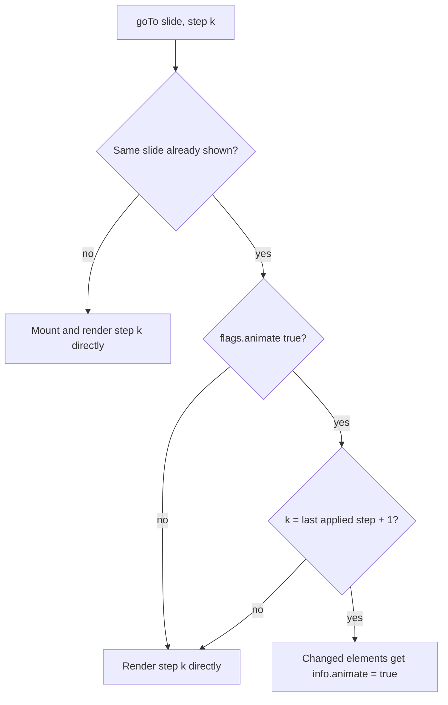

# Animation and motion

This page explains when a step change plays motion and what plays. It covers how long motion takes, how reduced motion and screenshots turn it off, and how to check that a played step ends exactly where a jump to it ends.

It is for two readers:

- **Deck authors**, who write slides by hand and want to know what the audience will see.
- **Component authors**, who write a component's `update()` and must keep the played-equals-jumped rule.

Agents writing decks should follow the [step model reference](../../skill/references/step-model.md) and the [checks reference](../../skill/references/checks.md) in the skill. Everything below comes from the engine code: `core/controller.js`, `core/animate.js`, `core/kit.js`, `core/stepdeck.js` and the built-in components.

## The rule: played equals jumped

A slide's look at step *k* depends only on step *k*. Motion is decoration on the way there. When a step finishes playing, or when it is cut short, the page must match exactly what you get by opening step *k* directly. Every built-in component writes its full target state at the end of `update()` and removes the inline styles its motion used. That is why a screenshot, a jump in the presenter view and a step played live all show the same slide.

## When motion plays

Only one kind of move animates: a **forward move of exactly one step from the last step that was applied** on the slide. Every other move renders the target state directly:

| Move | Animates? |
|---|---|
| First load of a slide (page load, slide change, reveal pre-mounting a neighbour) | No |
| Forward by one step (k to k+1) | Yes, if motion is on (see [below](#reduced-motion-capture-and-preview-frames)) |
| Forward by two or more steps | No |
| Backward, by any number of steps | No |
| Jump on the same slide by id or number (`STEPDECK.goTo`, a hash change in reveal) | Only if the target happens to be the next step after the one applied |

The engine decides this in the slide controller (`core/controller.js`), not in the components. It passes the decision to every changed element as `info.animate`:

```js
animate: animate && appliedIndex !== null && index === appliedIndex + 1
```

`animate` is the shell's request, which is `STEPDECK.flags.animate`. `appliedIndex` is the step the slide currently shows. It is `null` before the first step is applied, so the first render never animates.



Only elements whose resolved props or visibility changed get an `update()` call. An element that is the same at both steps is left alone, so a no-op step plays nothing.

### Interrupting motion

A new navigation aborts the motion in flight. Each element's `update()` gets an `AbortSignal` in `info.signal`. When the presenter presses the next key during a motion, the engine aborts that signal and every `ctx.animate` helper jumps straight to its end state and resolves. The engine then applies only the latest requested step. Steps requested in between are skipped. Pressing next quickly therefore lands on the right slide state; it does not queue up animations.

## Who decides what moves

Each component's code decides what moves. The engine only says whether motion is allowed (`info.animate`), how long it may take (`info.transition`), and when to stop (`info.signal`).

Every prop in a component's `schema.json` carries an `x-transition` annotation, one of `tween`, `draw`, `fade` or `snap`. This annotation is **metadata only**:

- The engine never reads it. `cli/ajv.js` registers it as a no-op schema keyword.
- `stepdeck catalog` uses it to list a component's `animates` props: every prop whose `x-transition` is not `snap`.
- No check verifies that the code does what the annotation says.

If you write a component, the annotation describes your `update()` code. It does not make anything move. See [custom components](../../skill/references/custom-components.md).

```sh
node cli/index.js catalog chart.bar
```

prints each prop with its `x-transition` value, and `catalog --json` lists `animates` per entry.

## How long motion takes

Durations come from three places: fixed defaults in `core/animate.js`, the theme token `--sd-duration` (read only by some components), and the step's `transition.duration`.

| Motion | Default | Where the default comes from | `transition.duration` |
|---|---|---|---|
| Fades, rises, draws and color changes in text, markdown, image, list, chat, diagram, timeline; big-number's fades | 400 ms | `DEFAULT_DURATION` in `core/animate.js` (a constant) | Replaces it |
| New terminal lines (fade) | 400 ms in academic-light | `--sd-duration` (400 ms when the token is missing) | Replaces it |
| chart.line and chart.bar (draw, morph, grow) | 800 ms in academic-light | 2 x `--sd-duration` | Replaces it (not doubled) |
| big-number count-up | 900 ms | `COUNT_UP_MS` in the component | Replaces it |
| Stagger between items (list, chat, diagram, terminal lines) | 60 ms | `DEFAULT_STAGGER` in `core/animate.js` | Not configurable; 0 when the duration is 0 |
| Terminal command typing | 28 ms per character, at most 1400 ms | `typingMs()` in `core/animate.js` | Ignored |
| Chat message typing | 28 ms per character, at most 1400 ms | `typingMs()` | Ignored, except that a duration of 0 skips typing |

All tweens use `easeCubicInOut` (JavaScript, in `core/animate.js`). Typing is linear.

What this means in practice:

- Changing `--sd-duration` in a theme changes only charts and terminal lines. The other components keep 400 ms.
- `transition: { duration: 0 }` on a step makes that step's changes snap into place. Chat typing and stagger delays are skipped too. Terminal command typing still runs at its own speed.

### Setting a duration on a step

`transition` is a step key: `{ duration, stagger }`, both in milliseconds. It applies to every element that changes at that step. This slide validates as written:

```js
export default {
  id: "count",
  layout: "statement",
  elements: [
    { id: "n", type: "big-number", props: { value: 1200, format: ",.0f", label: "participants" }, from: "shown" },
    { id: "src", type: "text", props: { text: "Source: survey, 2026", role: "source" }, region: "footer" },
  ],
  steps: [
    { id: "empty" },
    { id: "shown", transition: { duration: 1500 } },               // count up from 0 over 1.5 s
    { id: "more", set: { n: { value: 1800 } }, transition: { duration: 0 } }, // snap to 1,800
  ],
};
```

The schema accepts `transition.stagger`, but no component reads it today. Stagger stays at 60 ms.

## What each component does

Motion runs only when `info.animate` is true. "Enter" means the element became visible at this step. "Change" means its props changed while it stayed visible.

| Component | Enter | Change |
|---|---|---|
| [text](../../components/text/README.md) | Fades in | Fades in again when `text` changes |
| [markdown](../../components/markdown/README.md) | Fades in | Fades in again when `md` changes |
| [big-number](../../components/big-number/README.md) | Whole number fades in; value counts up from 0 | Counts from the previous value; a changed `label`, `ci`, `prefix`, `suffix` or `format` fades that part |
| [image](../../components/image/README.md) | Figure fades in | New `src` fades the picture in; a new caption fades the caption in |
| [chart.line](../../components/chart.line/README.md) | Every line draws in | Points morph (keyed by series and x) while the axes rescale; new series in `series_shown` draw in, leaving ones fade out; `highlight` fades opacity; annotations fade |
| [chart.bar](../../components/chart.bar/README.md) | Bars grow from 0, then whiskers draw | Values, `domain` and intervals tween; bars added to `shown` grow in, removed ones shrink out; `highlight` tweens colors |
| [terminal](../../components/terminal/README.md) | Nothing (see note) | When `shown` grows: with `typing`, the command is typed first if the session was at 0; then new lines fade in, staggered |
| [list](../../components/list/README.md) | Nothing (see note) | Newly shown items rise and fade in, staggered; a newly done check mark draws; `active` tweens text color |
| [chat](../../components/chat/README.md) | Nothing (see note) | Newly shown messages rise and fade in, staggered; with `typing`, the newest message is then typed |
| [diagram](../../components/diagram/README.md) | Nothing (see note) | New groups fade in; new nodes fade and scale in, staggered; then new edges draw (dashed ones fade) and their labels fade in; `highlight` tweens opacity and text color |
| [timeline](../../components/timeline/README.md) | Nothing (see note) | `progress` fill tweens from the previous value; a new `current` stop grows and its label fades in |

Notes:

- **No entry motion for terminal, list, chat, diagram and timeline.** These components compare their own before and after state (which items, lines or stops are shown). Becoming visible does not change that state, so an element that only appears at a step pops in without motion. To get motion, change a prop at the same step, for example raise `shown` on a list.
- **Changing `items` or `marker` on a list**, and any change that makes list, chat, diagram or timeline rebuild their markup, renders directly with no motion.
- **chart.bar skips motion when the bars are not comparable**: when `orient` changes, or when the set or order of categories changes. The new state is drawn directly. On enter it still grows every bar from 0.

## Reduced motion, capture and preview frames

`STEPDECK.flags` exposes two motion flags (set in `core/stepdeck.js`):

| Flag | Value |
|---|---|
| `motion` | `true` when the URL has `?motion=full`, or when the OS does not ask for reduced motion (`prefers-reduced-motion: reduce` is not set) |
| `animate` | `!capture && !receiver && motion` |

When `animate` is false, the shell never asks for motion, so every step renders directly. Three things turn it off:

- **Reduced motion.** A viewer whose system prefers reduced motion sees no motion. Add `?motion=full` to the URL to override that, for example when rehearsing on a machine with the setting on.
- **`?capture`.** Capture mode is for screenshots. It sets `ctx.capture`, adds the `capture` class to `<html>`, and `core/stepdeck.css` then turns off every CSS transition and animation (`html.capture *`). `shoot` and `dump` load pages this way.
- **`?receiver`.** The reveal speaker view's preview frames carry this flag. They never animate. When reduced motion is on and `?motion=full` is absent, they show a "motion off" badge.

## Inert options

These keys are accepted by the schema and by `validate` but do nothing yet:

- `enter` and `exit` on an element (`fade`, `rise`, `wipe`, `draw`, `none`). The engine copies them into the state and nothing reads them. Entry motion comes from each component (see the table above).
- `transition.stagger` on a step.

## Verifying with `check --played`

`check --played` tests the played-equals-jumped rule in a real browser. For every step *k* of a slide it measures the page three ways:

1. **Jumped**: a fresh page load at step *k* with `?motion=full`.
2. **Arrived from the previous step**: `goTo(k)` from *k*−1, with animation.
3. **Arrived from the next step**: `goTo(k)` from *k*+1, with no animation (a backward move).

It compares each element's presence, visibility, text and box (rounded to 1 px). Any difference is a `played-mismatch` problem, reported once per element with the number of other differing arrivals. A slide with *n* steps gives 2(*n*−1) arrivals.

Run it from the repo, with Playwright available:

```sh
STEPDECK_PLAYWRIGHT=/path/to/node_modules/playwright \
  node cli/index.js check examples/kit --played --slide tasks
```

```
check: 1 slide, 5 steps, 8 played arrivals compared, 0 problems
```

Add `--step <ref>` (with `--slide`) to compare only the arrivals at that step (two, or one at the first or last step).

Things to know:

- **It refuses to run when animation is off.** If `STEPDECK.flags.animate` is not `true` on the page, the command stops with exit code 2 and the message `animation is off on the page (flags …); check --played cannot test the animated path`. This prevents a silent test of two jumps. Because it loads pages with `?motion=full`, reduced motion on your machine does not trigger this.
- **It does not compare props or inline styles.** A leftover inline `opacity` or `transform` with the same text and box passes. Component authors must still clear their inline styles at the end of `update()`, for example with `clearInlineStyle()` from `core/animate.js`.
- **The watchdog.** Every `mount()` and `update()` call must settle within 10 seconds (`SETTLE_TIMEOUT_MS`). An element that does not is failed with `<slide>/<element>: did not settle within 10s`, gets no further updates, and shows up as a `render-error` in `check`.

Without `--played`, `check` and `validate` never play motion.

## For component authors

- Read `info.animate` (or `canAnimate(info)` from `core/kit.js`) before playing anything, and pass `info.signal` to every `ctx.animate` helper. On abort, the helpers jump to their end state and resolve; they reject only when your own callback throws.
- Use `motion(info)` from `core/kit.js` to get `{ signal, duration }` for the helpers, or `motionMs(info, ctx, factor)` to scale `--sd-duration` the way the charts do.
- Write the full target state at the end of `update()`, whether the motion ran, was aborted or never started. Then remove inline styles.
- Never derive the end state from `info.prev` or from earlier calls. `prev` is only the starting point for motion.
- Keep motion well under 10 seconds.
- Set `x-transition` on each prop to match what your code does, so `catalog` reports it correctly.

## Motion tokens in the theme

`themes/academic-light/tokens.css` declares three motion tokens:

| Token | Value | Used by |
|---|---|---|
| `--sd-duration` | `400ms` | chart.line, chart.bar (x2) and terminal lines, through `motionMs()` |
| `--sd-duration-fast` | `200ms` | Nothing today |
| `--sd-easing` | `cubic-bezier(0.65, 0, 0.35, 1)` | Nothing today. JavaScript motion uses `easeCubicInOut` from `core/animate.js` |

Setting `--sd-duration-fast` or `--sd-easing` in a theme currently has no effect.
