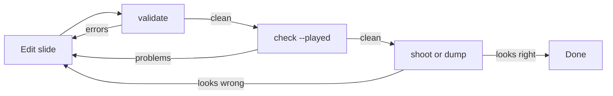

# Checking a deck

This page shows how to verify a deck with the stepdeck CLI. It covers what each command checks, how to read a problem line, and how to work through a deck until it is clean. It is for people who write decks by hand and for people who run agents that build decks. Every rule is described in [Rules](../reference/rules.md), and every flag in [CLI](../reference/cli.md).

The examples run from the `stepdeck` folder against `../my-talk`, the deck made in the [Quickstart](quickstart.md). Its `chart` slide has four steps: `base`, `compare`, `mark` and `latest`.

## Why check

A slide is data that only shows its faults when it renders, and it renders differently at every step. One loop of commands catches the faults you would otherwise find on stage:

| Fault | Caught by |
| --- | --- |
| Schema errors: unknown keys, wrong types, unknown components, layouts or regions | `validate` |
| Data errors: missing files, bad JSON pointers, bad formats, missing CSV columns | `validate` |
| Text outside the canvas or its region, overlapping text | `check` |
| Text below the audience minimum font size, low contrast | `check` |
| Runtime errors: elements that fail, console errors, failed requests | `check` (and `dump`) |
| A step that looks different when played than when jumped to | `check --played` |
| Anything a rule cannot judge: crowding, a wrong figure, a bad build order | `shoot` or `dump`, then your eyes |

The loop is:



A slide is done when `validate`, `check` and `check --played` all exit 0 and the shots look right.

## Requirements

| Command | Runs in | Needs |
| --- | --- | --- |
| `validate` | Node | The repository's dependencies (Ajv): run `npm install` in the `stepdeck` folder once. Without them, validate stops with exit 2 and says so. |
| `check`, `dump`, `shoot` | Chrome, driven by Playwright | Playwright, which is not a dependency of the repository. Install it where Node can resolve it (`npm install playwright`), or set `STEPDECK_PLAYWRIGHT` to a `playwright` package folder. The browser is your system Chrome; set `STEPDECK_CHANNEL` to use another Playwright channel. |

The browser commands serve the deck from a local server and block every request to another origin. They need a deck with its own engine copy (`my-talk/stepdeck/`, made by `new`), or a deck inside the stepdeck repository, such as `examples/kit`.

```sh
export STEPDECK_PLAYWRIGHT=/path/to/node_modules/playwright
```

## validate: schemas, data and steps, in Node

```sh
node cli/index.js validate ../my-talk
```

```
validate: 3 slides, 0 errors, 0 warnings
```

`validate` needs no browser and takes about a second. It checks the deck, then each slide. For each slide it folds every step and checks the resolved props of every element at every step, including elements that are hidden at that step. Each problem is reported once, at the first step where it appears.

Problems have a severity:

- **error**: the deck is wrong. Any error makes validate exit 1.
- **warning**: the deck works, but something is probably unintended. The warnings are `noop-step` (a step whose state equals the previous step's, so a click shows nothing new), `kicker-no-region` (a `section` on a layout with no `title` region), `title-accent` (an unmatched `*` in a title) and `accent-empty` (`**` in a title). Warnings are printed with a `warning:` prefix, and validate still exits 0 when there are only warnings.

Narrow it to one slide with `--slide`:

```sh
node cli/index.js validate ../my-talk --slide chart
```

`validate` rejects `--step`, because it always folds and checks every step of a slide:

```
stepdeck: validate does not take --step: it folds and checks every step of a slide; use --slide <id>
```

## check: layout and runtime errors, in Chrome

```sh
node cli/index.js check ../my-talk
```

```
check: 3 slides, 6 steps, 0 problems
```

`check` loads every step of every slide on a fresh page, waits for fonts and for every component to settle, and measures the text on screen. It reports:

- **Layout rules**: `text-outside-canvas`, `text-outside-region`, `text-overlap`, `font-too-small` (below the theme's audience minimum; source lines and the `footer` region are exempt) and `contrast` (below 4.5:1).
- **Page errors**: `render-error` (an element or slide the engine reported as failed), `console-error` (a console error or uncaught exception) and `network-error` (a request that failed, answered HTTP 400 or more, or went to another origin).
- **`step0-shows-all`**: a slide with more than one step whose step 0 already shows what its last step shows.

The page is 1920 x 1080 by default, the size of the canvas. `--size n` measures in an `n` x `n`·9/16 viewport instead, for example `--size 960` for 960 x 540. Boxes and positions stay in canvas pixels at any size.

A layout problem that persists over several steps is reported once, at its first step, with `(+N more steps)`.

### check --played: played against jumped

```sh
node cli/index.js check ../my-talk --slide chart --played
```

```
check: 1 slide, 4 steps, 6 played arrivals compared, 0 problems
```

`--played` adds a second pass. Every step is reached three ways: by jumping straight to it, by arriving animated from the step before, and by arriving from the step after. The three results are compared per element by visibility, text and box (rounded to 1 px). A difference is a `played-mismatch`, reported once per element, at the first differing arrival, with `(+N more differing arrivals)`. It almost always means a component's `update()` depends on earlier calls or leaves animation residue. The built-in components pass; look at your custom components.

A slide with `n` steps gives `2(n − 1)` arrivals, so the four-step `chart` slide gives 6.

`--played` runs every `check` rule first, then the played pass, so a clean `check --played` implies a clean `check`.

The played pass loads pages with `?motion=full`, so it animates even when your system asks for reduced motion; there is nothing to set up. If the page still reports that animation is off, the run stops with exit 2 instead of quietly comparing jumps with jumps.

## dump: what is on screen at each step, as text

```sh
node cli/index.js dump ../my-talk --slide chart --step mark
```

```
chart · step 2 (mark)
  visible  title   text        96,96 1728×74         "Group B overtakes Group A after 2020"
  visible  chart   chart.line  96,218 1096×754       "0 10 20 30 40 2016 2018 2020 2022 2024 2020 Gro…"
  visible  note    text        1264,443 560×83       "From 2020 on, Group B rises three times faster …"
  hidden   latest  big-number  1264,562 560×184      "37.3 Group B in 2024, per 1,000"
  visible  source  text        96,996 1728×36        "Source: synthetic example data (data/make-data.…"
  changed: chart, note
```

For each step, `dump` lists every element with:

- whether it is visible, as measured on the page;
- its box `x,y w×h` in canvas pixels (a collapsed element is `0,0 0×0`);
- the start of its text;
- `changed`: the ids whose resolved props or visibility differ from the previous step (every id at step 0);
- `error:` lines for any engine, console or page error seen at that step.

Each step is a fresh page load, so a dump is always what the audience sees after a jump. Use it when you cannot look at images, or to diff two versions of a slide cheaply.

With `--json` each element also carries `props`, its resolved props (bindings applied):

```sh
node cli/index.js dump ../my-talk --slide chart --json
```

```json
[
  {
    "slide": "chart",
    "step": 0,
    "stepId": "base",
    "elements": [
      { "id": "title", "type": "text", "visible": true, "text": "…", "box": { "x": 96, "y": 96, "w": 1728, "h": 74 }, "props": { "text": "…" } }
    ],
    "changed": ["title", "chart", "note", "latest", "source"],
    "errors": []
  }
]
```

`dump` exits 1 when any step has errors. A failed request (a 404, a blocked remote request) shows in `errors` only as Chrome's console line (`console: Failed to load resource: …`), without the URL, and it still makes `dump` exit 1. `check` reports the request itself as `network-error`, with its URL and its HTTP status or the reason it failed.

## shoot: a PNG per step

```sh
node cli/index.js shoot ../my-talk --slide chart
```

```
../my-talk/shots/960/chart-00-base.png
../my-talk/shots/960/chart-01-compare.png
../my-talk/shots/960/chart-02-mark.png
../my-talk/shots/960/chart-03-latest.png
shoot: 4 PNGs at 960×540
```

Files go to `<deck>/shots/<size>/<slide>-<nn>-<stepId>.png`, where `nn` is the step index padded to two digits (more for a slide with 100 steps or more). A step without an id uses its index, as in `title-00-0.png`. The printed paths are relative to the folder you run from; `--json` prints absolute paths.

| `--size` | Image size |
| --- | --- |
| `960` (default) | 960 x 540, roughly what a video-call audience sees |
| `1280` | 1280 x 720 |
| `1920` | 1920 x 1080, the full canvas |

Any other size is a usage error. `shoot` overwrites the files it writes and never deletes others. After you rename a slide or a step, delete `shots/` (or `shots/<size>/<slide>-*`) before shooting again, or old PNGs will sit next to the new ones.

Open every PNG of the slide and ask: is the right thing visible at each step, is anything clipped, is anything crowded?

## Reading a problem

Every problem prints as one line:

```
slide/element/step · rule · measured vs limit · fix
```

Here is `validate` on a `chart` slide with three mistakes: a region typo, a misspelled prop and an empty step called `pause`:

```
chart/note · unknown-region · region 'note' vs regions of figure-notes: title, main, notes, footer · set region: "notes"
chart/chart/base · unknown-prop · prop 'seriesShown' vs props of chart.line: data, x, y, series, series_shown, highlight, annotate, axes, format, types, interval · rename 'seriesShown' to 'series_shown' (props of chart.line)
warning: chart/pause · noop-step · same elements, props and visibility as the previous step vs a step changes something on screen · merge step 'pause' into the previous step (move its notes there), or give it a patch
validate: 1 slide, 2 errors, 1 warning
```

- **Location.** `slide/element/step`, with the parts that do not apply left out. `chart/note` is an element problem that does not depend on a step; `chart/pause` is a step problem with no element; a deck-wide problem prints `deck`. The step is the step id, or its index for a step without an id.
- **Rule.** The rule name. Look it up in [Rules](../reference/rules.md).
- **measured vs limit.** What was found, and what was expected.
- **Fix.** One suggested edit, often with a did-you-mean. It is usually the exact change to make.

With `--json` you get an array of objects with the same parts:

```json
{
  "slide": "chart",
  "element": "note",
  "step": null,
  "rule": "unknown-region",
  "measured": "region 'note'",
  "limit": "regions of figure-notes: title, main, notes, footer",
  "fix": "set region: \"notes\"",
  "severity": "error"
}
```

`slide`, `element` and `step` are `null` when they do not apply. `measured`, `limit` and `fix` are always strings. Only `validate` adds `severity` (`"error"` or `"warning"`). In `check` output, the `(+N more steps)` note is part of the `measured` string:

```json
{
  "slide": "chart",
  "element": "note",
  "step": "mark",
  "rule": "text-outside-region",
  "measured": "text at 1264,107 530×129 (+1 more step)",
  "limit": "inside region 'notes' at 1264,218 560×754",
  "fix": "shorten the text, break long words, or give the region more room (the slide's `regions` grid variables)"
}
```

## Narrowing a run, and trying another theme

| Flag | Commands | Effect |
| --- | --- | --- |
| `--slide <id>` | `validate`, `check`, `dump`, `shoot` | Only that slide. An unknown id stops the run with exit 2 and lists the slides. |
| `--step <ref>` | `check`, `dump`, `shoot` | Only that step: a step id, or a step index. Needs `--slide`. |
| `--theme <name>` | `check`, `dump`, `shoot` | Run under another theme (adds `?theme=` to every page) instead of the deck's own. A bad name stops the run with exit 2 before any browser starts. `validate` has no such flag. |

`--step` without `--slide` is an error (`--step needs --slide`), and so is `--step` on any other command. With `--step`:

- `check` measures only that step, compares only its two arrivals under `--played`, and skips `step0-shows-all`, which needs both ends of the slide;
- `dump` also loads the step before, to compute `changed`;
- `shoot` writes one PNG.

To see how a deck looks under the other built-in theme, run the same command with `--theme academic-light` (or `--theme modern`): a deck that is clean under one theme can still overflow under the other, because the type differs (the cover title, for one).

Narrowing keeps runs short: a full `check` takes a few seconds per slide. When several people or agents work on one deck, each should pass `--slide` for the slide they own.

## Working through problems

1. **Run `validate` first.** It is fast and catches most mistakes. Fix every error line.
2. **Rerun it.** Validate skips a slide's later steps after a `set`, `replace`, `show` or `hide` names an unknown element (a bad `only` skips just its own step), and skips its per-step checks while a `step-ref` error stands. Fixing those can bring new lines into view.
3. **Run `check`.** Fix `render-error`, `console-error` and `network-error` lines first: `check` does not measure an element that already failed, so its layout problems show only after it renders.
4. **Run `check --played`** once `check` is clean.
5. **Shoot or dump, and look.** A clean `check` means no rule fired, not that the slide works. A note that grows to fill most of its region still passes, as long as its text stays inside.

## What no rule catches yet

These pass `validate` and `check`. Look for them in the shots or the dump.

| Problem | What you see | What to do |
| --- | --- | --- |
| A chart, diagram, image or terminal in `statement` `main` | The element collapses to zero height. In `dump` its box reads, for example, `1500×0`. | Move it to a region with a height of its own, such as `main` of `figure-notes` or `full-bleed`, or a `halves` half. See the [Fill rules](../reference/layouts.md#fill-rules) table. |
| `chart.line` `series_shown` or `highlight` naming a series the data does not have | The unknown names are ignored: missing lines, or every series dimmed. | Check the names against the CSV. (`chart.bar` reports unknown categories as an error.) |
| `list` `active` or `done` given as an integer out of range | Nothing is marked, or every item is done. | Use an index inside the list, or use item ids, which are checked. |
| A `diagram` node whose `col`/`row` lies outside `cols`/`rows` | The node is drawn outside the diagram. `check` reports it only when its label lands outside the region or the canvas. | Keep every node, with its spans, inside the grid. |

For errors that stop a deck from loading or a command from running, see [Troubleshooting](../troubleshooting.md).

## Using the checks in CI

| Exit code | Meaning |
| --- | --- |
| `0` | Clean. For `validate`, warnings only also exit 0. |
| `1` | Problems: any `validate` error, any `check` problem, any `dump` step with errors. `shoot` exits 0 when it writes its files. |
| `2` | A usage error, or a run that could not complete: no `deck.js`, an unknown `--slide` or step, Ajv or Playwright missing, a deck with no engine copy, or animation off under `--played`. |

```sh
node cli/index.js validate ../my-talk --json > validate.json
node cli/index.js check ../my-talk --played --json > check.json
```

What `--json` prints:

- `validate --json`: the array of problems, warnings included. Filter on `severity` rather than counting the array.
- `check --json`: the array of problems only. The counts in the text summary line (slides, steps, played arrivals) are not included.
- `dump --json`: the array of steps. `shoot --json`: the array of absolute PNG paths.
- A run that could not complete prints `{ "error": "<message>" }` on stdout and exits 2, for example `{ "error": "unknown slide 'nope' (slides: title, chart, closing)" }`.

Argument errors are never JSON, even with `--json`. An unknown option, a flag without its value, a bad `--size` or `--port`, an unknown command, and a `shoot --size` other than 1920, 1280 or 960 all print `stepdeck: <message>` (with the usage text for parse errors) on stderr and exit 2. A CI script should treat exit 2 with empty stdout as a broken invocation, not as a deck problem. Flags a command does not use, other than `--step`, are ignored.

## See also

- [Rules](../reference/rules.md): every `validate` and `check` rule, what triggers it and how to fix it.
- [CLI](../reference/cli.md): every command, option and output format.
- [The stepdeck skill](../../skill/SKILL.md): the build-and-check loop an agent follows, with [checks.md](../../skill/references/checks.md) as its rule reference.
