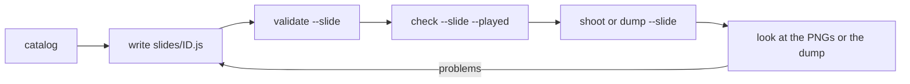

# stepdeck for AI agents

This page explains how AI agents use stepdeck and where these docs fit next to the agent skill. It is for two readers: agents that write decks, and the people who install, configure and steer those agents.

An agent that lands on the repository starts at [`AGENTS.md`](../../AGENTS.md) at its root: it routes to the skill (to make a deck) or to the contributing pages (to change stepdeck), and states the invariants of each. `GEMINI.md` points to it, and [`llms.txt`](../../llms.txt) lists the same files in reading order.

The short version: an agent works from [the stepdeck skill](../../skill/SKILL.md), the generated catalog and CLI output. This page does not repeat the skill. It says what the skill contains, how to install it, which outputs a script or agent can parse, and what `docs/` adds when the skill is not enough.

## The skill

The skill is the folder [`skill/`](../../skill/). It holds one entry file and seven references:

| File | What it covers |
|---|---|
| [`skill/SKILL.md`](../../skill/SKILL.md) | Setup, the workflow, the rules agents trip on, working in parallel, presenting. |
| [`references/design.md`](../../skill/references/design.md) | Design defaults: one claim per slide, what a step is for, which layout and component for which job, how much fits, what to look for in the shots. |
| [`references/step-model.md`](../../skill/references/step-model.md) | States, visibility (`from`, `at`, `collapse`, `ghost`), `set`, `replace`, `show`, `hide`, `only`, `advance`, notes, transitions, entrances and exits (`enter`, `exit`), the `lede`, step ids. |
| [`references/components.md`](../../skill/references/components.md) | The built-in components, bindings and data files. |
| [`references/custom-components.md`](../../skill/references/custom-components.md) | When and how to write a deck component. |
| [`references/themes-layouts.md`](../../skill/references/themes-layouts.md) | Layouts and regions, tokens, palettes, `{{color:role}}`, the audience font, adding a theme or layout. |
| [`references/checks.md`](../../skill/references/checks.md) | Every `validate`, `check` and `catalog` rule, what each means and how to fix it, and the known limits. |
| [`references/cookbook.md`](../../skill/references/cookbook.md) | Complete slide specs that pass `validate` and `check --played`. |

The skill tells the agent to read the catalog and never engine source (`stepdeck/core/`, `stepdeck/components/*/index.js`, `stepdeck/vendor/`). Data files in the engine copy (`example.js`, `README.md`, `schema.json`, `tokens.css`, `palettes.json`, `layout.css`) are fine to read, and so are the finished slide specs in `site/gallery/slides/` and `examples/kit/slides/`. The next place the skill sends the agent is `docs/reference/components/<name>.md`. If all of these leave a question open, the agent is told to say so in its report.

### Install it as a Claude Code plugin

The repository root is a Claude Code plugin and a one-plugin marketplace. In Claude Code:

```
/plugin marketplace add horaciochacon/stepdeck
/plugin install stepdeck@stepdeck
```

[`.claude-plugin/marketplace.json`](../../.claude-plugin/marketplace.json) lists the plugin, with the repository root as its source. [`.claude-plugin/plugin.json`](../../.claude-plugin/plugin.json) declares the skill folder:

```json
{
  "name": "stepdeck",
  "version": "0.1.0",
  "skills": ["./skill"]
}
```

(Excerpt; the file also has `description`, `author`, `license`, `homepage`, `repository` and `keywords`.)

From a clone, load it for one session with the plugin folder flag, as the README does:

```sh
claude --plugin-dir /path/to/stepdeck
```

Any other agent reads [`AGENTS.md`](../../AGENTS.md), which sends it to `skill/SKILL.md`.

In the skill, `$STEPDECK` stands for the absolute path of the repository: the folder that holds `cli/index.js`. The skill is not standalone; it needs the CLI and the engine beside it. From the plugin, `$STEPDECK` is `${CLAUDE_PLUGIN_ROOT}`; read from a clone, it is the parent of `skill/`. The agent either exports it in the same shell call as the command or writes the path out. Only `validate` needs `npm install` in that folder (for Ajv). The browser commands need Playwright, resolved from the repository's `cli/` folder, so it is installed there (`npm run playwright`, after any `npm install`, which would remove it) or named with `STEPDECK_PLAYWRIGHT`; installing it in the deck does nothing. See [Quickstart](quickstart.md#requirements).

## The loop the skill prescribes

The skill starts with a plan (one claim per slide, each title written as that claim, what each click adds). Then, for each slide, it has the agent run this loop until every command exits 0 and the screenshots look right:



The commands, run on a deck made with `new` (here `my-talk`):

```sh
node "$STEPDECK/cli/index.js" catalog my-talk                          # writes my-talk/catalog/
node "$STEPDECK/cli/index.js" catalog chart.line my-talk               # one entry, as text
node "$STEPDECK/cli/index.js" validate my-talk --slide chart           # Node only, fast
node "$STEPDECK/cli/index.js" check my-talk --slide chart --played     # headless Chrome
node "$STEPDECK/cli/index.js" shoot my-talk --slide chart              # my-talk/shots/960/chart-<nn>-<step>.png
node "$STEPDECK/cli/index.js" dump my-talk --slide chart --json        # text, boxes and props per step
```

A slide is done when `validate` and `check --played` exit 0 and the shots look right. `check --played` runs everything plain `check` does, then the played pass.

The browser commands load every slide that `deck.js` lists, even with `--slide`, so the skill tells the agent to add an id to `slides` only when its file exists.

### One slide per agent

Each slide is its own file, so several agents can work on one deck at once. The skill sets these rules:
- each agent owns `slides/<id>.js`, plus the data files and custom components only it uses;
- one owner edits `deck.js` (the slide order and the `components` list);
- shared data files are generated by one script and treated as read-only;
- every `validate`, `check`, `dump` and `shoot` call passes `--slide <id>`, so no agent runs the whole deck. Shots are named by slide, so two agents shooting at once write different files.

`--step <id>` (with `--slide`) narrows `check`, `dump` and `shoot` to one step. `validate` rejects it, because it always folds every step of a slide.

## The catalog: the machine-readable source

The catalog is what an agent reads instead of source code. `catalog` reads only data files (each component's `schema.json` and `README.md`, each layout's `schema.json` and `README.md`, each theme's `tokens.css`, `palettes.json` and `README.md`, plus the deck's `deck.js` for its `components` list) and never imports component code.

| Command | Output |
|---|---|
| `catalog my-talk` | Writes `my-talk/catalog/index.json` and one `my-talk/catalog/<name>.json` per entry. Stale `*.json` files there are removed first. Prints a summary line. |
| `catalog my-talk --json` | Writes the same files and prints the entries array (the content of `index.json`). |
| `catalog <name> my-talk` | Prints one entry as text: props with transition, required flag, description and examples. Writes nothing. |
| `catalog <name> my-talk --json` | Prints one entry's full detail as JSON. Writes nothing. |

The name and the folder can come in either order. Without a folder, `catalog` uses the current folder; run from the repository root, it writes `<repo>/catalog/` (git-ignored). A deck reads its engine copy (`my-talk/stepdeck/`) plus its own `deck.js` `components`.

An entry in `index.json` has five keys:

```json
{
  "kind": "component",
  "name": "big-number",
  "summary": "One large figure with an optional label and 95% interval.",
  "animates": ["value", "format", "label", "ci", "prefix", "suffix"],
  "enter": "own"
}
```

`summary` is the first sentence of the schema's description (for a theme, of its README's first paragraph). `animates` lists the props whose `x-transition` is not `snap`; it is empty for layouts and themes. `enter` is `"own"` when the component builds its own entrance (its schema declares `"x-enter": "own"`: the charts, `big-number`, `list`, `chat`, `diagram`, `terminal`, `timeline`), and `"box"` when the engine moves the element's box instead (every other component, and every layout and theme).

The detail adds, by kind:

| Kind | Extra keys |
|---|---|
| component | `origin` (`built-in` or `deck`), `description`, `required`, `props` (per prop: `required`, `x-transition`, `description`, `examples`, `default` when set, `schema`), `readme`, `example` |
| layout | `description`, `regions`, `variables`, `readme`, `example` |
| theme | `description`, `tokens` (the `:root` custom properties of `tokens.css`), `palettes` (`palettes.json`), `readme` |

A built-in component's or a layout's `example` path is relative to the engine, so in a deck it lives at `my-talk/stepdeck/<example>`. A deck component's (`origin: "deck"`) is relative to the deck, so it lives at `my-talk/<example>` (for example `my-talk/components/<name>/example.js`). Example slides show the shape; their data files are not in your deck. The full shapes are in [CLI reference: catalog](../reference/cli.md).

Run `catalog` again after adding a custom component. It then lists the component with `origin: "deck"`.

## Machine-readable outputs

Every command except `help` accepts `--json` and then writes JSON to stdout.

| Command | `--json` output |
|---|---|
| `validate` | Array of problems, each with `severity` (`error` or `warning`). |
| `check` | Array of problems. |
| `dump` | Array of steps: `{ slide, step, stepId, elements: [{ id, type, visible, ghost?, text, box, canvas?, props }], changed, errors }`. |
| `shoot` | Array of absolute PNG paths. |
| `catalog` | Entries array, or one detail with a name (see above). |
| `serve` | `{ url, root, port }`, then the server keeps running until SIGINT or SIGTERM. |
| `new`, `new-component` | What was created, including the next commands or the line to add to `deck.js`. |
| `boundaries` | `{ file, sourceFile, regions, points, license, sourceLine, warnings, replaced }`: the GeoJSON and source file written into the deck (absolute paths), their size, the licence and a source line for the slide. |

A problem has the same shape in `validate` and `check`, except that only `validate` adds `severity`:

```json
{
  "slide": "chart",
  "element": "chart",
  "step": "base",
  "rule": "missing-column",
  "measured": "x = 'yeer'",
  "limit": "columns of data/series.csv: year, group, value",
  "fix": "set x to 'year'",
  "severity": "error"
}
```

Without `--json` the same problem is one line, `slide/element/step · rule · measured vs limit · fix`:

```
chart/chart/base · missing-column · x = 'yeer' vs columns of data/series.csv: year, group, value · set x to 'year'
```

`slide`, `element` and `step` are `null` when they do not apply. `step` is the step id, or the step index as a string when the step has no id. [Rules](../reference/rules.md) lists every `rule` value.

### Exit codes

| Code | Meaning |
|---|---|
| `0` | Clean. `validate` also exits 0 when it finds warnings only. |
| `1` | Problems. `validate`: at least one error. `check`: any problem. `dump`: any step with a non-empty `errors`. |
| `2` | Usage error, or a run that could not complete: no `deck.js`, an unknown `--slide` or `--step`, an option the command does not take, Playwright missing, a deck with no engine copy, animation off during `check --played`. |

`shoot`, `catalog`, `new`, `new-component` and `serve` exit 0 when they finish. `boundaries` exits 0 when it wrote its files, warnings or not, and 2 when it could not (an unknown country or level, no network, an answer it cannot read).

### Caveats for parsers

- **Parse errors are never JSON.** An unknown option, a flag with no value, a bad `--port` or `--size`, an unknown command and an invalid `shoot --size` print `stepdeck: <message>` (plus usage, except for `shoot --size`) to stderr and exit 2, even with `--json`. Other failures under `--json` print `{ "error": "<message>" }` to stdout and exit 2.
- **`catalog --json` drops problems.** Without `--json`, `catalog` prints `catalog-schema` and `catalog-name` problems as `warning:` lines. With `--json` and no name, only the entries array is printed; the warnings are not reported anywhere. Run `catalog` once without `--json` to see them.
- **No summary counts in JSON.** `validate --json` and `check --json` print only the problems array. The slide, step and played-arrival counts appear only in the text summary line.
- **`dump` lists failed requests.** A step's `errors` holds render errors, console or page errors, and each failed request as `network: 404 /path` (the same request `check` reports as `network-error`), so a missing file is named in `dump` too.
- **A flag a command does not take is refused.** `validate --played`, `validate --size 960` and the like print `stepdeck: validate does not take --played (check does)` and exit 2, instead of running as if the flag had been applied. `--json`, `--help` and `--version` are accepted everywhere.
- **`--size` defaults differ.** `check` and `dump` measure at 1920 x 1080 unless you pass `--size`; `shoot` defaults to 960 and accepts only 1920, 1280 or 960. Boxes are always in canvas pixels.

## Where docs/ goes deeper than the skill

The skill is written to be short: it covers what an agent needs to build a slide. `docs/` is the exhaustive version, for the person steering the agent and for an agent whose question the skill leaves open.

| Page | What it adds |
|---|---|
| [`reference/components/`](../reference/components/index.md) | An exhaustive reference, one page per built-in component. The skill gives one paragraph per component and leaves props to the catalog. |
| [`reference/rules.md`](../reference/rules.md) | The full list of `validate`, `check` and `catalog` rules, with the code location and exact wording of each. |
| [`reference/runtime-api.md`](../reference/runtime-api.md) | `boot()`, `window.STEPDECK`, the query flags and the shells. Of the query flags, the skill mentions only `?motion=full`. |
| [`reference/cli.md`](../reference/cli.md) | Every command, option, output shape and exit code. |
| [`guide/maps-from-your-code.md`](maps-from-your-code.md) | For a map slide: what the project's own R or Python code makes and what stepdeck does with it, the exact file shapes, the writer functions to copy into that code, and which side fixes which error. The skill states the rule; this page has the details. |
| [`troubleshooting.md`](../troubleshooting.md) | The error catalogue: common error messages and what to do about each. |

Point an agent at one of these pages when a run fails in a way the skill's `checks.md` does not explain, or when you need behaviour the catalog does not state. These pages describe the engine; they are not engine source, so reading them does not break the skill's rule.

## When the skill and these docs disagree

The code wins. The skill, these docs and the catalog are all descriptions of the code in `core/`, `components/`, `layouts/`, `themes/` and `cli/`. When two of them disagree:
1. Trust what the CLI does. A command's output and exit code are the ground truth for an agent.
2. Report the drift: the file, the line and what the code does instead. An agent should say so in its report; a person should open an issue or fix the doc.
