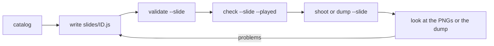

# stepdeck for AI agents

This page explains how AI agents use stepdeck and where these docs fit next to the agent skill. It is for two readers: agents that write decks, and the people who install, configure and steer those agents.

The short version: an agent works from [the stepdeck skill](../../skill/SKILL.md), the generated catalog and CLI output. This page does not repeat the skill. It says what the skill contains, how to install it, which outputs a script or agent can parse, and what `docs/` adds when the skill is not enough.

## The skill

The skill is the folder [`skill/`](../../skill/). It holds one entry file and six references:

| File | What it covers |
|---|---|
| [`skill/SKILL.md`](../../skill/SKILL.md) | Setup, the workflow, the rules agents trip on, working in parallel, presenting. |
| [`references/step-model.md`](../../skill/references/step-model.md) | States, visibility (`from`, `at`, `collapse`), `set`, `replace`, `show`, `hide`, `only`, `advance`, notes, transitions, step ids. |
| [`references/components.md`](../../skill/references/components.md) | The built-in components, bindings and data files. |
| [`references/custom-components.md`](../../skill/references/custom-components.md) | When and how to write a deck component. |
| [`references/themes-layouts.md`](../../skill/references/themes-layouts.md) | Layouts and regions, tokens, palettes, `{{color:role}}`, the audience font, adding a theme or layout. |
| [`references/checks.md`](../../skill/references/checks.md) | The `validate`, `check` and `catalog` rules agents usually meet, what each means and how to fix it, and the known limits. |
| [`references/cookbook.md`](../../skill/references/cookbook.md) | Complete slide specs that pass `validate`, `check` and `check --played`. |

The skill tells the agent to read the catalog and never engine source (`stepdeck/core/`, `stepdeck/components/*/index.js`, `stepdeck/vendor/`). Data files in the engine copy (`example.js`, `README.md`, `schema.json`, `tokens.css`, `palettes.json`, `layout.css`) are fine to read. If the skill and the catalog leave a question open, the agent is told to say so in its report.

### Install it as a Claude Code plugin

The repository root is a Claude Code plugin. [`.claude-plugin/plugin.json`](../../.claude-plugin/plugin.json) declares the skill folder:

```json
{
  "name": "stepdeck",
  "version": "0.1.0",
  "skills": ["./skill"]
}
```

(Excerpt; the file also has `description`, `author`, `license` and `keywords`.)

Load it in Claude Code with the plugin folder flag, as the README does:

```sh
claude --plugin-dir /path/to/stepdeck
```

Any other agent can read `skill/SKILL.md` directly.

In the skill, `$STEPDECK` stands for the absolute path of the repository folder that holds `skill/`. The agent either exports it in the same shell call as the command or writes the path out. Only `validate` needs `npm install` in that folder (for Ajv). The browser commands need Playwright; see [Quickstart](quickstart.md#requirements).

## The loop the skill prescribes

For each slide, the skill has the agent run this loop until every command exits 0 and the screenshots look right:



The commands, run on a deck made with `new` (here `my-talk`):

```sh
node "$STEPDECK/cli/index.js" catalog my-talk                          # writes my-talk/catalog/
node "$STEPDECK/cli/index.js" catalog chart.line my-talk --json        # one entry in full
node "$STEPDECK/cli/index.js" validate my-talk --slide chart           # Node only, fast
node "$STEPDECK/cli/index.js" check my-talk --slide chart --played     # headless Chrome
node "$STEPDECK/cli/index.js" shoot my-talk --slide chart              # my-talk/shots/960/chart-<nn>-<step>.png
node "$STEPDECK/cli/index.js" dump my-talk --slide chart --json        # text, boxes and props per step
```

A slide is done when `validate`, `check` and `check --played` all exit 0 and the shots look right.

### One slide per agent

Each slide is its own file, so several agents can work on one deck at once. The skill sets these rules:
- each agent owns `slides/<id>.js`, plus the data files and custom components only it uses;
- one owner edits `deck.js` (the slide order and the `components` list);
- shared data files are generated by one script and treated as read-only;
- every `validate`, `check`, `dump` and `shoot` call passes `--slide <id>`, so no agent runs the whole deck. Shots are named by slide, so two agents shooting at once write different files.

`--step <id>` (with `--slide`) narrows `check`, `dump` and `shoot` to one step. `validate` rejects it, because it always folds every step of a slide.

## The catalog: the machine-readable source

The catalog is what an agent reads instead of source code. `catalog` reads only data files (each component's `schema.json` and `README.md`, each layout's `schema.json` and `README.md`, each theme's `tokens.css`, `palettes.json` and `README.md`, plus the deck's `deck.js` for its `components` list) and never imports component code.

| Command | Output |
|---|---|
| `catalog my-talk` | Writes `my-talk/catalog/index.json` and one `my-talk/catalog/<name>.json` per entry. Stale `*.json` files there are removed first. Prints a summary line. |
| `catalog my-talk --json` | Writes the same files and prints the entries array (the content of `index.json`). |
| `catalog <name> my-talk` | Prints one entry as text: props with transition, required flag, description and examples. Writes nothing. |
| `catalog <name> my-talk --json` | Prints one entry's full detail as JSON. Writes nothing. |

The name and the folder can come in either order. Without a folder, `catalog` uses the current folder; run from the repository root, it writes `<repo>/catalog/` (git-ignored). A deck reads its engine copy (`my-talk/stepdeck/`) plus its own `deck.js` `components`.

An entry in `index.json` has five keys:

```json
{
  "kind": "component",
  "name": "big-number",
  "summary": "One large figure with an optional label and 95% interval.",
  "animates": ["value", "label", "ci"],
  "enter": "own"
}
```

`summary` is the first sentence of the schema's description (for a theme, of its README's first paragraph). `animates` lists the props whose `x-transition` is not `snap`; it is empty for layouts and themes. `enter` is `"own"` when the component builds its own entrance (its schema declares `"x-enter": "own"`: the charts, `big-number`, `list`, `chat`, `diagram`, `terminal`, `timeline`), and `"box"` when the engine moves the element's box instead (every other component, and every layout and theme).

The detail adds, by kind:

| Kind | Extra keys |
|---|---|
| component | `origin` (`built-in` or `deck`), `description`, `required`, `props` (per prop: `required`, `x-transition`, `description`, `examples`, `default` when set, `schema`), `readme`, `example` |
| layout | `description`, `regions`, `variables`, `readme`, `example` |
| theme | `description`, `tokens` (the `:root` custom properties of `tokens.css`), `palettes` (`palettes.json`), `readme` |

A built-in component's or a layout's `example` path is relative to the engine, so in a deck it lives at `my-talk/stepdeck/<example>`. A deck component's (`origin: "deck"`) is relative to the deck, so it lives at `my-talk/<example>` (for example `my-talk/components/<name>/example.js`). Example slides show the shape; their data files are not in your deck. The full shapes are in [CLI reference: catalog](../reference/cli.md).

Run `catalog` again after adding a custom component. It then lists the component with `origin: "deck"`.

## Machine-readable outputs

Every command except `help` accepts `--json` and then writes JSON to stdout.

| Command | `--json` output |
|---|---|
| `validate` | Array of problems, each with `severity` (`error` or `warning`). |
| `check` | Array of problems. |
| `dump` | Array of steps: `{ slide, step, stepId, elements: [{ id, type, visible, ghost?, text, box, props }], changed, errors }`. |
| `shoot` | Array of absolute PNG paths. |
| `catalog` | Entries array, or one detail with a name (see above). |
| `serve` | `{ url, root, port }`, then the server keeps running until SIGINT or SIGTERM. |
| `new`, `new-component` | What was created, including the next commands or the line to add to `deck.js`. |

A problem has the same shape in `validate` and `check`, except that only `validate` adds `severity`:

```json
{
  "slide": "chart",
  "element": "chart",
  "step": "base",
  "rule": "missing-column",
  "measured": "x = 'yeer'",
  "limit": "columns of data/series.csv: year, group, value",
  "fix": "set x to 'year'",
  "severity": "error"
}
```

Without `--json` the same problem is one line, `slide/element/step · rule · measured vs limit · fix`:

```
chart/chart/base · missing-column · x = 'yeer' vs columns of data/series.csv: year, group, value · set x to 'year'
```

`slide`, `element` and `step` are `null` when they do not apply. `step` is the step id, or the step index as a string when the step has no id. [Rules](../reference/rules.md) lists every `rule` value.

### Exit codes

| Code | Meaning |
|---|---|
| `0` | Clean. `validate` also exits 0 when it finds warnings only. |
| `1` | Problems. `validate`: at least one error. `check`: any problem. `dump`: any step with a non-empty `errors`. |
| `2` | Usage error, or a run that could not complete: no `deck.js`, an unknown `--slide` or `--step`, Playwright missing, a deck with no engine copy, animation off during `check --played`. |

`shoot`, `catalog`, `new`, `new-component` and `serve` exit 0 when they finish.

### Caveats for parsers

- **Parse errors are never JSON.** An unknown option, a flag with no value, a bad `--port` or `--size`, an unknown command and an invalid `shoot --size` print `stepdeck: <message>` (plus usage, except for `shoot --size`) to stderr and exit 2, even with `--json`. Other failures under `--json` print `{ "error": "<message>" }` to stdout and exit 2.
- **`catalog --json` drops problems.** Without `--json`, `catalog` prints `catalog-schema` and `catalog-name` problems as `warning:` lines. With `--json` and no name, only the entries array is printed; the warnings are not reported anywhere. Run `catalog` once without `--json` to see them.
- **No summary counts in JSON.** `validate --json` and `check --json` print only the problems array. The slide, step and played-arrival counts appear only in the text summary line.
- **`dump` errors have no failed-request list.** A step's `errors` holds render errors and console or page errors, but not the `404 <url>` lines that `check` reports as `network-error`. Chrome still logs its own `console: Failed to load resource: ... 404 (Not Found)` error for a 404, and that line does land in `errors`, so `dump` exits 1; it does not name the URL. Run `check` and read its `network-error` problem for the URL.
- **Unused flags are ignored.** Only `--step` is rejected on commands that do not take it. `--played`, `--template`, `--port` and `--size` are silently ignored elsewhere.
- **`--size` defaults differ.** `check` and `dump` measure at 1920 x 1080 unless you pass `--size`; `shoot` defaults to 960 and accepts only 1920, 1280 or 960. Boxes are always in canvas pixels.

## Where docs/ goes deeper than the skill

The skill is written to be short: it covers what an agent needs to build a slide. `docs/` is the exhaustive version, for the person steering the agent and for an agent whose question the skill leaves open.

| Page | What it adds |
|---|---|
| [`reference/components/`](../reference/components/index.md) | An exhaustive reference, one page per built-in component. The skill gives one paragraph per component and leaves props to the catalog. |
| [`reference/rules.md`](../reference/rules.md) | The full list of `validate`, `check` and `catalog` rules, including rules the skill's `checks.md` does not list. |
| [`reference/runtime-api.md`](../reference/runtime-api.md) | `boot()`, `window.STEPDECK`, the query flags and the shells. Of the query flags, the skill mentions only `?motion=full`. |
| [`reference/cli.md`](../reference/cli.md) | Every command, option, output shape and exit code. |
| [`troubleshooting.md`](../troubleshooting.md) | The error catalogue: common error messages and what to do about each. |

Point an agent at one of these pages when a run fails in a way the skill's `checks.md` does not explain, or when you need behaviour the catalog does not state. These pages describe the engine; they are not engine source, so reading them does not break the skill's rule.

## When the skill and these docs disagree

The code wins. The skill, these docs and the catalog are all descriptions of the code in `core/`, `components/`, `layouts/`, `themes/` and `cli/`. When two of them disagree:
1. Trust what the CLI does. A command's output and exit code are the ground truth for an agent.
2. Report the drift: the file, the line and what the code does instead. An agent should say so in its report; a person should open an issue or fix the doc.

Known drift at the time of writing:

| Where | What the doc says | What the code does |
|---|---|---|
| `skill/SKILL.md` frontmatter | Lists line chart, big number, terminal session, text and markdown. | `components/index.json` has 12 built-ins, adding `chart.bar`, `chart.points`, `list`, `diagram`, `chat`, `timeline` and `image`. |
| `skill/references/checks.md`, `unknown-layout` | Use `title`, `figure-notes` or `full-bleed`. | `statement` and `halves` exist too. The problem's `limit` lists every known layout (`figure-notes`, `full-bleed`, `halves`, `statement`, `title`), and its `fix` suggests the closest one or lists them all. |
| `skill/references/checks.md` | Has no `diagram-id` or `diagram-overlap` rows. | `validate` reports both for `diagram` elements. |
| `skill/references/checks.md`, `figure-source` | A figure is `chart.*` or `big-number`. | `cli/validate.js` also counts `map` and `map.*` (no such component exists yet). |
| `skill/SKILL.md`, `checks.md` | Never mention `--size`; shots go to `shots/960/` by default. | `shoot` takes `--size` 1920, 1280 or 960 (default 960); `check` and `dump` take `--size` as the viewport width (default 1920). |
| `skill/SKILL.md`, workflow step 1 (Catalog) | The `example` path in an entry is relative to the engine (`my-talk/stepdeck/<path>`). | True for built-in components and layouts. A deck component's `example` is relative to the deck: `components/<name>/example.js`. |
