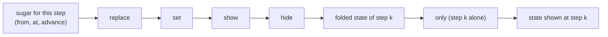

# The step model

This page explains how a slide's steps turn into the states the audience sees. It covers the step patches (`set`, `replace`, `show`, `hide`, `only`), the visibility sugar (`from`, `at`), `advance`, step references and `collapse`, with worked examples. It is written for people who write slides by hand and for people who run agents that write them.

Agents have their own, shorter version of this page: [skill/references/step-model.md](../../skill/references/step-model.md). It covers the same model in less detail. For every key of a deck and a slide, see [reference/deck-and-slide.md](../reference/deck-and-slide.md).

## The core idea: a state is a fold

A slide is a list of **elements** and an optional list of **steps**. Each step is a patch. The state at step `k` is:

1. every element's step-0 definition (its `props`, visible unless sugar says otherwise),
2. folded through the patches of steps `0, 1, …, k` in order,
3. plus step `k`'s own `only`, applied on top and never kept.

The engine (`core/fold.js`, function `stateAt`) computes this directly for any `k`. It never replays the talk. So opening a slide at step 3, clicking forward from step 2 and taking a screenshot of step 3 all start from the same state and must end in the same markup. Components may animate on the way, but they always finish at the state the fold gives. `check --played` verifies this for every step (rule `played-mismatch`).

## Steps and step references

A slide with `n` steps has states `0 … n−1`. The first entry of `steps` is the patch for step 0, the first state the audience sees. A slide with no `steps` has exactly one state.

| Slide | Number of states |
|---|---|
| `steps` missing or `[]` | 1 |
| `steps` with `n` entries | `n` |

A step reference (in `from`, `at`, `advance.start`, `--step`, a URL) is either:

- an integer `>= 0`: the step's 0-based index, or
- a step `id`: a non-empty string.

Prefer ids. Inserting a step shifts every index after it, but ids stay put.

Step ids must not be digits only (`"2"`, `"02"`). Validate rejects them with the rule `step-id-numeric`, because the URL and the CLI read an all-digit string as an index: `?step=2`, `#/trend/2` and `--step 2` all mean the third step, never a step whose id is `"2"`. Use words or `step-2`. An empty step value in a URL means step 0.

## Element initial state

Before any step applies, each element starts as:

| Field | Initial value |
|---|---|
| `props` | the element's `props` (or `{}`) |
| `visible` | `true`, unless `from` or `at` hides it at step 0 |
| `collapse` | `true` only when the element sets `collapse: true` |

The slide `title: "…"` is sugar for an element with the reserved id `title` (type `text`, region `title`, `props: { text }`). It is a normal element, so a step can change it: `set: { title: { text: "A new title" } }`.

### Hidden versus collapsed

A hidden element is still in the page. How it takes space depends on `collapse`:

| Element | Hidden with | Space |
|---|---|---|
| default | `visibility: hidden` (class `sd-hidden`) | kept: nothing on screen moves when it appears |
| `collapse: true` | `display: none` (class `sd-collapsed`) | removed: the region reflows when it appears |

From `examples/spike/slides/hello.js`:

```js
elements: [
  { id: "lead", region: "main", type: "text", props: { text: "Slides are data: a layout, elements and steps." } },
  { id: "reveal", region: "main", type: "text", from: "two", props: { text: "This paragraph appears at step two; its space was reserved." } },
  { id: "aside", region: "main", type: "text", from: "two", collapse: true, props: { role: "note", text: "This note takes no space until it appears." } },
  { id: "src", region: "main", type: "text", props: { role: "source", text: "Source: synthetic example." } },
],
steps: [{ id: "one" }, { id: "two" }],
```

At step `one`, the gap for `reveal` is already there; `aside` takes no room, so `src` sits higher until step `two`.

## Patch order inside one step

A step can hold several operations. They always apply in this order:



| Op | Shape | Effect | Folds into later steps |
|---|---|---|---|
| `replace` | `{ <id>: { …all props } }` | Replaces the element's props wholesale. | yes |
| `set` | `{ <id>: { <prop>: value } }` | [RFC 7396](https://www.rfc-editor.org/rfc/rfc7396) merge patch on the props: nested objects merge, arrays and scalars replace, `null` deletes the key. | yes |
| `show` | `["id", …]` | Makes the elements visible. | yes |
| `hide` | `["id", …]` | Makes the elements hidden. | yes |
| `only` | like `set` | Merge patch applied on top of step `k`, for step `k` alone. | no |
| `notes` | string | Speaker notes for this step. | no |
| `transition` | `{ duration, stagger }` (ms, both `>= 0`) | Passed to the components that change at this step. | no |

Two consequences of the order:

- `replace` and `set` on the same element in one step: the `set` lands on top of the replaced props.
- `show` and `hide` of the same element in one step: `hide` wins.

To delete one prop, set it to `null`: `set: { chart: { highlight: null } }`. Never write `set: { chart: null }`. That makes the props `null`, which validate reports as `props-not-object`.

### Worked example: patch order

```js
export default {
  id: "order",
  elements: [
    { id: "msg", type: "text", props: { text: "Draft", role: "note" } },
    { id: "tip", type: "text", from: "edit", props: { text: "Tip" } },
  ],
  steps: [
    { id: "start" },
    { id: "edit", replace: { msg: { text: "Final" } }, set: { msg: { role: "label" } } },
    { id: "plain", set: { msg: { role: null } }, show: ["tip"], hide: ["tip"] },
    { id: "back", show: ["tip"] },
  ],
};
```

The states, as `stateAt` returns them:

| Step | `msg` props | `tip` visible | Why |
|---|---|---|---|
| `start` | `{ text: "Draft", role: "note" }` | no | `from: "edit"` hides `tip` before `edit` |
| `edit` | `{ text: "Final", role: "label" }` | yes | `replace` drops `role`, then `set` adds `role: "label"`; sugar shows `tip` |
| `plain` | `{ text: "Final" }` | no | `null` deletes `role`; `show` then `hide`, so `hide` wins |
| `back` | `{ text: "Final" }` | yes | the explicit `show` folds forward from here |

### Worked example: a figure that builds up

`examples/spike/slides/trend.js` builds a line chart over five steps:

```js
elements: [
  { id: "chart", region: "main", type: "chart.line",
    props: { data: "data/dose-response.csv", x: "dose_mg", y: "responders", series: "regimen",
             series_shown: ["single"],
             axes: { x: "Dose (mg)", y: "Participants responding" },
             format: { y: ",.0f" } } },
  { id: "n1", region: "notes", type: "text", from: "annotate",
    props: { text: "Above 250 mg the curve steepens." } },
  { id: "big", region: "notes", type: "big-number", from: "total",
    props: { value: "{{data/summary.json#/responders}}", format: ",.0f", label: "participants responding at 500 mg on the combined regimen" } },
  { id: "src", region: "footer", type: "text", props: { role: "source", text: "Source: synthetic example data." } },
],
steps: [
  { id: "base" },
  { id: "regimens", set: { chart: { series_shown: ["single", "combined"] } } },
  { id: "annotate", set: { chart: { annotate: [{ x: 250, label: "250 mg" }] } } },
  { id: "focus", only: { chart: { highlight: "combined" } }, notes: "Pause here." },
  { id: "total", set: { chart: { y: "rate", axes: { y: "Responders per 1,000" } } } },
],
```

The folded states (the title and `src` are visible throughout):

| Step | `chart` props that differ from step 0 | `n1` | `big` | Notes |
|---|---|---|---|---|
| 0 `base` | none | hidden | hidden | `""` |
| 1 `regimens` | `series_shown: ["single", "combined"]` | hidden | hidden | `""` |
| 2 `annotate` | + `annotate: [{ x: 250, label: "250 mg" }]` | visible | hidden | `""` |
| 3 `focus` | + `highlight: "combined"` (from `only`) | visible | hidden | `"Pause here."` |
| 4 `total` | `series_shown`, `annotate`, `y: "rate"`, `axes.y: "Responders per 1,000"`; no `highlight` | visible | visible | `""` |

Three things to notice:

- `set` at `total` merges into `axes`: `axes.x` stays `"Dose (mg)"`, only `axes.y` changes.
- The highlight from `only` at `focus` is gone at `total`; it was never folded.
- Notes do not fold either: `total` has no `notes` and the slide has none, so its notes are empty.

You can see the same states in the browser measurements:

```sh
node cli/index.js dump examples/spike --slide trend
```

`dump` needs a browser: set `STEPDECK_PLAYWRIGHT` to a playwright package folder (see the README). It lists, per step, which elements are visible and which ids changed since the previous step (`changed: chart, n1` at `annotate`, `changed: chart, big` at `total`).

## `only`: a change for one step

`only` is a merge patch, like `set`, applied on top of the folded state of its own step. It is never folded, so the next step starts from the state before it. Use it for a highlight or emphasis that should last one click. `only` changes props only; it cannot show or hide an element (use `at` for a one-step appearance).

## Visibility sugar: `from` and `at`

| Key | On an element | Visible at |
|---|---|---|
| `from: <ref>` | `from: "annotate"` | that step and every later one |
| `at: [<ref>, …]` | `at: ["base", "focus"]` | only the listed steps |

Rules:

- If an element sets both, `from` wins and `at` is ignored. Use one.
- Sugar is applied before the step's own patch, so an explicit `show` or `hide` in the same step wins.
- Sugar emits a `show` or `hide` only at the steps where it changes the element's visibility, starting from visible. An explicit `show` or `hide` therefore lasts past its own step, until the sugar next changes that element. In the patch-order example above, `tip` has `from: "edit"`; the `hide` at `plain` holds until the `show` at `back`, because `from` never changes `tip` again after `edit`.
- For a change that lasts exactly one step, use `at`, not `show` plus `hide`.

## `advance`: one prop, one value per step

Components with an internal sequence (a terminal session, a list, a chat, a timeline) are driven by props only; a component never reads the step number. `advance` writes the patches for one prop:

```js
advance: { prop, values, start = 0 }
```

`props[prop] = values[j]` at step `start + j`. Before `start`, the element's own `props` hold, so always give the prop an initial value. After the last value, that value holds, because `set` folds.

From `examples/kit/slides/criteria.js`:

```js
{ id: "list", region: "main", type: "list",
  props: { marker: "letter", rule: true, shown: 1, items: [ /* four items */ ] },
  advance: { prop: "shown", values: [1, 2, 3, 4], start: "a" } },
// …
steps: [{ id: "a" }, { id: "b" }, { id: "c" }, { id: "d" }],
```

| Step | `a` | `b` | `c` | `d` |
|---|---|---|---|---|
| `shown` | 1 | 2 | 3 | 4 |

Details:

- `advance` is sugar, so an explicit `set` of the same prop in a step wins at that step.
- Values that would land past the last step are dropped at runtime. Validate reports them as `advance-overflow`: `start + values.length` must not exceed the number of steps.
- Two sequenced elements on one slide each get their own `advance`, aligned by step ids.

## Notes and transitions

| Field of the state at step `k` | Value |
|---|---|
| notes | `step.notes`, else `slide.notes`, else `""` |
| transition | `step.transition`, else `null` |

Neither folds: each step reads only its own entry. The transition reaches every component that updates at that step (`info.transition`). `transition.duration` (ms) overrides the components' default motion length at that step. `transition.stagger` is accepted and passed on, but no built-in component reads it yet. See [Animation and motion](animation-and-motion.md) for which moves animate and the default durations.

## Fields that are accepted but have no effect yet

The schema accepts these, and validate passes them, but nothing in this version reads them:

| Field | Where | Note |
|---|---|---|
| `enter`, `exit` (`fade`, `rise`, `wipe`, `draw`, `none`) | element | Components animate their own entry instead. |
| `sections` | deck | No section footer is drawn. |
| `seconds` | slide | Records planned speaking time only. |

## Common mistakes and the rules that catch them

Run `node cli/index.js validate <deck>` after every change; `check` needs a browser (set `STEPDECK_PLAYWRIGHT`, see the README). Problems print as `slide/element/step · rule · measured vs limit · fix`; location parts that are missing are left out. Validate starts each warning with `warning: `.

| Mistake | Rule | Command | Severity |
|---|---|---|---|
| A patch names an element that does not exist (`set: { laed: … }`) | `unknown-element` | validate | error |
| `from`, `at` or `advance.start` names a step that does not exist | `step-ref` | validate | error |
| A step id is digits only (`{ id: "2" }`) | `step-id-numeric` | validate | error |
| Two steps share an id | `duplicate-step-id` | validate | error |
| `advance` has more values than steps from `start` | `advance-overflow` | validate | error |
| A step after step 0 changes nothing on screen (an empty step, or one with only `notes`) | `noop-step` | validate | warning |
| Step 0 already shows everything the last step shows | `step0-shows-all` | check | error |
| Jumping to a step and playing into it end in different markup | `played-mismatch` | check `--played` | error |

For example, this slide (`slides/oops.js`, wrapped in `export default { … }`), in a scratch deck whose only slide it is (`deck.js`: `export default { title: "t", lang: "en", slides: ["oops"] };`):

```js
id: "oops",
title: "Mistakes",
elements: [
  { id: "lead", type: "text", props: { text: "Lead" } },
  { id: "late", type: "text", from: "thrid", props: { text: "Later" } },
  { id: "count", type: "text", props: { text: "0" }, advance: { prop: "text", values: ["1", "2", "3", "4"], start: "b" } },
],
steps: [
  { id: "a" },
  { id: "b", set: { laed: { text: "Lead, again" } } },
  { id: "2" },
  { id: "b" },
],
```

gives:

```text
oops/2 · step-id-numeric · step id '2' vs not digits only (digits mean a step number) · rename step '2' to a word, e.g. 'step-2', and update its references
oops/b · duplicate-step-id · step id 'b' used twice vs unique per slide · rename step 3 to a new id
oops/late · step-ref · from "thrid" vs steps: a, b, 2, b · use one of the step ids 'a', 'b', '2', 'b'
oops/count · advance-overflow · 4 values from step 'b' vs 3 steps from there · add 1 step after 'b' or drop the last 1 value of advance.values
oops/b · unknown-element · set names 'laed' vs elements: title, lead, late, count · change 'laed' to 'lead' in set
validate: 1 slide, 5 errors, 0 warnings
```

`step0-shows-all` fires when a slide has more than one step and step 0 already has the same visible elements, text and props as the last step. Hide elements until their step (`from`, `at`), change props per step (`set`, `only`, `advance`), or drop the extra steps. Slides driven by `advance` change props, so they do not trip it.

For every rule and its fix, see [skill/references/checks.md](../../skill/references/checks.md).

## See also

- [reference/deck-and-slide.md](../reference/deck-and-slide.md): every key of `deck.js` and a slide file.
- [skill/references/step-model.md](../../skill/references/step-model.md): the agent version of this page.
- [Animation and motion](animation-and-motion.md): which step changes animate, and how long they take.
